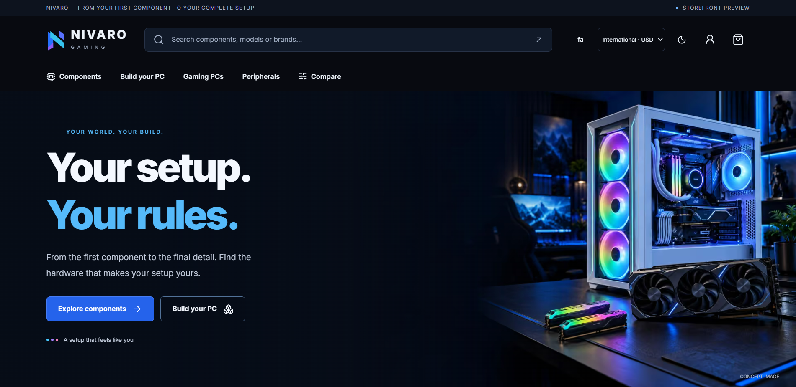
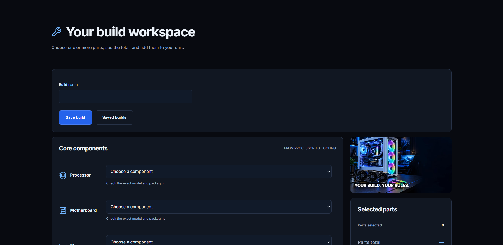
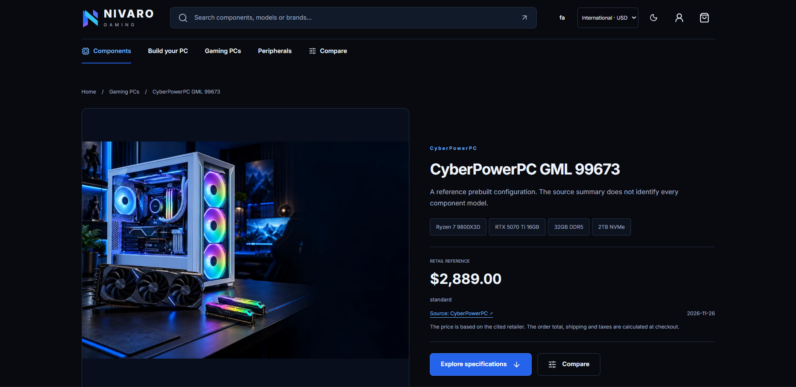

# Nivaro Gaming

A bilingual gaming hardware storefront built with Next.js and six FastAPI services. Browse components and ready-built systems in Persian or English, compare hardware, and build a parts list for either the Iranian or international market. The storefront supports light and dark themes.



## Build a PC

Select one or more components, see the running total for the chosen market, and add the selection to the cart. A signed-in customer can save a named parts list for later.



## Catalog and product details

Product pages show specifications, package options, and the retailer and observation date for the reference price. The two markets have independent offers and ready-built system lineups.



## Current delivery

P01–P12 are verified for local release. The Docker runtime serves the storefront, simulator checkout, staff administration and private support. GitHub Actions passed the isolated database and media restore, browser recovery journeys, Catalog cache interruption and development hot reload on the verified P12 implementation revision. See the [phase evidence](docs/progress.md#p12-verification-complete) and [release backup, restore and rollback guide](docs/runbooks/BACKUP_RESTORE.md).

Use the [clean release guide](docs/runbooks/LOCAL_RELEASE.md) to build and run the full stack from a clean checkout. The [delivery guide](docs/DELIVERY.md) includes architecture diagrams, browser evidence and demonstration steps. The configured Windows launcher below starts the current owner runtime with the support, order, payment and media overlays. For a media-only stack with already built images:

```powershell
docker compose -f compose.yaml -f compose.media.yaml up -d --no-build --pull never --wait
```

For a fresh setup initialize both local and media secrets, then build with the base Compose configuration and include the media overlay when starting. The older base-only commands below describe storefront/development operation and do not mount media or start its workers. See [catalog media operations](services/catalog/README.md#p04-catalog-media-runtime) for exact candidate tests, permissions, retention and queue-recovery behavior.

The storefront, product collection and details, same-category comparison, and PC builder use the catalog API. PostgreSQL stores products, physical variants, and independent market offers. The [design reference register](docs/design/PAGE_DESIGNS.md) records the storefront layouts.

The seed contains 14 documented products, with 12 priced listings in each market. Shared parts have independent Iranian and USD price references, and each market has its own ready-built systems. The development overlay initializes simulator inventory so selected parts can be added to the local cart. Product detail pages show price sources and observation dates. Customer login uses allowlisted mock codes, and administrator login uses separate credentials. See [the catalog price data](services/catalog/src/nivaro_catalog/data/retail-offers.json) and [identity setup](services/identity/README.md).

## Local development

On the configured Windows workstation, use `http://localhost:8080/fa`. The
`Nivaro Local Development` task starts the local Compose stack and Watch when
the owner signs in. Web source and public asset edits sync into the running
development container after Docker Desktop is available, including when it
starts later in the session. Cart, catalog, identity and orders APIs reload their locally
mounted Python source. Workers use their selected images, and database migrations
remain explicit verified updates.

To register or restart the launcher from the repository root, run the following
after initializing the existing local and media secrets and building the base
backend images. The launcher includes Orders and the reservation event workers.

```powershell
./scripts/Start-LocalDev.ps1 -Install
```

The watcher writes `work/local-dev-watch.log`. Source-only frontend updates
reuse the running image. Webpack polls files inside the container so edits
synchronized by Compose reach the open browser tab through Fast Refresh.
Package manifest and lockfile edits rebuild the web
image through [Compose Watch](https://docs.docker.com/compose/how-tos/file-watch/).
Stop and disable the Windows task before switching the same local project back
to the release configuration.

Requires Node 24 and pnpm 11.25.0. The project pins pnpm and direct dependencies; do not force peer dependencies.

```powershell
cd apps/web
pnpm install --frozen-lockfile
$env:CATALOG_URL='http://127.0.0.1:8080'
pnpm dev --port 8081
```

Start the Compose catalog/gateway first, then open `http://localhost:8081/fa` or `http://localhost:8081/en`. This fallback runs on the host, not in Docker. See [progress](docs/progress.md) for actual verification evidence and container limitations.

## Docker development

```powershell
./scripts/Initialize-LocalSecrets.ps1
docker compose -f compose.yaml -f compose.dev.yaml up --build --watch
```

The gateway binds only to `127.0.0.1:8080`; web is internal. Source/public assets sync via Compose Watch, dependency manifests trigger rebuild. Windows node_modules never enter Linux containers. Do not remove volumes or prune the user's Docker environment.

```powershell
docker compose up -d --build
docker compose ps
```

Base Compose builds non-root web/catalog releases and runs migrations/seed in a one-shot init service. Release and development web images have distinct local tags (`nivaro-web:release` and `nivaro-web:development`). Base images are pinned in Compose. Local release execution and Compose Watch were reverified on 2026-10-28; clean builds also passed in private CI. See [progress](docs/progress.md). Initial registry/package access is still needed on a clean machine. For the complete owner-assisted base-image list, see [download preparation](docs/DOWNLOAD_PREPARATION.md), and for bounded-download recovery see [catalog operations](services/catalog/README.md#bounded-download-local-recovery).

This phase uses the pinned Node, Caddy, Python 3.13.18 and PostgreSQL 18.6 images already present locally. The owner can pull these manually. Optional explicit Arvan mirror paths, without changing Docker Desktop globally:

```powershell
docker pull docker.arvancloud.ir/node:24.22.1-bookworm-slim
docker pull docker.arvancloud.ir/caddy:2.11.7
$env:NODE_IMAGE='docker.arvancloud.ir/node:24.22.1-bookworm-slim'
$env:CADDY_IMAGE='docker.arvancloud.ir/caddy:2.11.7'
docker compose -f compose.yaml -f compose.dev.yaml up --build --watch
```

The path convention follows [Arvan's Docker documentation](https://www.arvancloud.ir/fa/dev/docker). The owner successfully downloaded all seven planned base/tool images through this mirror on 2026-10-27 after transient failures. Package installation inside the build still needs npm registry access on a clean cache even after base images are available. Keep TLS verification enabled. Clearing these overrides restores the pinned Compose defaults; the download helper creates the canonical local aliases automatically.

For a host production preview, set `CATALOG_URL=http://127.0.0.1:8080` for both build and start, then run `pnpm build` and `pnpm start --port 8081` inside `apps/web`. The launcher copies public/static assets into Next's standalone output and defaults to loopback. Stop that preview before rebuilding on Windows, and before binding Docker's gateway to the same port.

## Checks

```powershell
cd apps/web
pnpm lint
pnpm typecheck
$env:CATALOG_URL='http://127.0.0.1:8080'
pnpm build
pnpm exec playwright install chromium
pnpm test:e2e
```

Browser tests expect the app at `http://127.0.0.1:8080`; override `TEST_BASE_URL` when needed. `CHROMIUM_EXECUTABLE` can use an already installed browser. Tests cover both locales/themes at 360, 768 and 1440 pixels, filters and validation, empty results, market/language isolation, comparison retry, conservative assembly findings, dialog focus and reduced motion. Screenshots and reports are ignored runtime outputs; curated evidence belongs in `docs/evidence/`.

For backend checks, contract regeneration and disposable fresh-database verification, follow [catalog operations](services/catalog/README.md). Private CI also tests database changes reaching the rendered storefront and actual catalog outage/recovery.

With development Compose Watch running, `node scripts/verify-watch.mjs` from `apps/web` verifies a reversible footer edit reaches the existing browser document, then restores the source and verifies the restoration. Run it without concurrent footer editing. Loopback `127.0.0.1` is explicitly permitted in Next's development-only origin list so the HMR connection works through Caddy. No wildcard origin allowance is used.

## Project documentation

See the [product and architecture roadmap](docs/NIVARO_ROADMAP_EN.md), [verification history](docs/progress.md), and [delivery guide](docs/DELIVERY.md). Local payments and sign-in use a payment simulator and mock codes.

## License

Project software and documentation are available under the [MIT License](LICENSE). Third-party dependencies, fonts, and reference material are subject to their respective terms.
