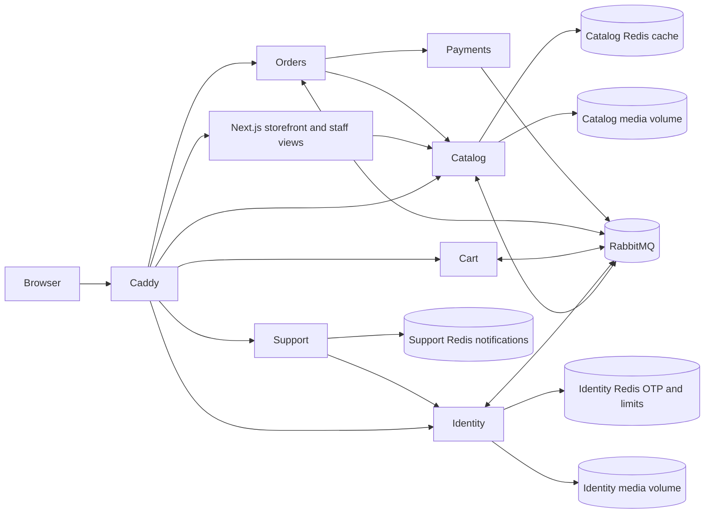
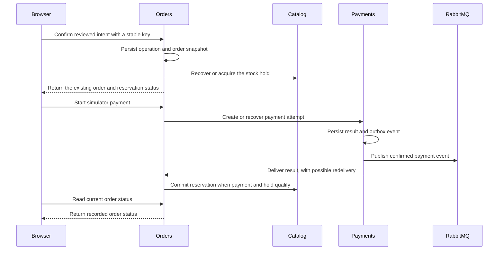

# Nivaro Gaming delivery

Nivaro is a bilingual, single-vendor gaming hardware storefront and PC assembly project. The browser supports Persian RTL, English LTR and light and dark themes. Iranian rial offers display in tomans. International USD offers use independent prices and availability. See the [local Docker release guide](runbooks/LOCAL_RELEASE.md), [incident procedures](runbooks/INCIDENTS.md) and [verification history](progress.md).

## Runtime architecture

Catalog owns products, rules, quotes, availability and holds. Cart owns versioned carts and saved builds. Orders owns checkout, purchase snapshots, coupons and fulfillment. Payments owns attempts, captured amounts and refunds. Identity owns customers, staff permissions and sessions. Support owns private conversations and message history. Each service uses its own database and database role on one PostgreSQL instance. Caddy publishes the local port. Workers and service-to-service endpoints are on the Compose network. See the [canonical architecture decisions](NIVARO_ROADMAP_EN.md#final-architectural-decisions).

- Checkout uses stable operation and line IDs, revision-bound compatibility and quote inputs, and price, address and configuration snapshots. Virtual builds draw from component inventory. Stocked prebuilts draw from their finished SKU. Cart additions leave stock available until checkout holds it.
- Payment and fulfillment effects use durable state, outbox publication and idempotent consumption. An ambiguous payment remains in review or reconciliation until the relevant evidence becomes available. Staff access is permission-scoped and recorded.
- Support commits messages and read cursors to PostgreSQL. Redis distributes private change notifications. A browser reconnects from its last contiguous sequence. Media processing likewise uses persisted jobs and activates only ready derivatives. Backups include the database state and both media volumes. [Restore drill evidence](progress.md#p12-isolated-backup-and-restore)

## Three-minute demonstration

1. Open `/fa` and switch to `/en`, then toggle the theme. Browse a product and compare items in the same category. Switch markets and show the independent offer data and any missing information explicitly displayed by Catalog.
2. Open the PC builder, pick one piece, and add it to the cart. Add a set of parts and show the selected total and the matching cart lines. In the disposable browser fixture, confirm checkout, retry after a dropped response and open the same order. Select **Pay with simulator** and show the recorded result in customer history and the staff order view.
3. Open separate synthetic customer and staff sessions to show private Support. Send a message, reconnect and show that history recovers. Finish by showing the isolated restore report and the protected avatar check.

The checkout and Support demonstrations use the synthetic policies, users and fixtures in `Verify-OrdersFoundation.ps1 -WithPaymentResults -Browser` and `Verify-SupportFoundation.ps1 -Browser`. Run with their documented images and the frozen browser test dependencies. The plain release seed supplies documented retail references. The Windows Docker development overlay loads the simulator inventory used in the parts-picker demonstration.

| Browser evidence | Capture |
| --- | --- |
| Persian storefront, dark desktop | [Storefront verification](evidence/storefront-fa-dark.png) |
| English mobile order awaiting simulator payment | [Interrupted-confirmation browser exercise](evidence/simulator-checkout-en-mobile.png) |
| Persian mobile Support with a synthetic conversation | [Support read receipt exercise](evidence/support-fa-mobile.png) |

## Verification and limitations

| Environment | Evidence |
| --- | --- |
| Local Docker | Seven release images built from the archive with an empty application build cache. Database/media restore, customer reads and both localized storefront routes passed with those images. [Local phase evidence](progress.md#p12-clean-build-and-delivery-package) |
| GitHub Actions | P12 passed on exact implementation revision `f47f27a25387a8fd5a31e887ddb44790b55b8544`, including the isolated database/media restore, recovery browser journeys and Docker development hot reload. [P12 run](https://github.com/saeedzed2002/Nivaro/actions/runs/45840448826) |
| Simulator | OTP, payments, fulfillment, reconciliation and refunds use synthetic fixtures. Demo prices, delivery, tax and inventory are test inputs. |
| Live providers | Public hosting, live payments and SMS, actual market policies and representative recovery objectives require separate deployment evidence. |
