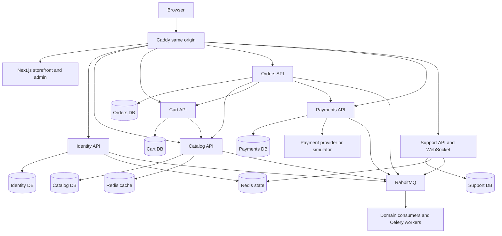

# Nivaro Gaming — Project Roadmap and Implementation Handoff

**CANONICAL PROJECT SPECIFICATION FOR AI AGENTS.** Read this English document for architecture, requirements, implementation planning, and handoff. `docs/NIVARO_ROADMAP.md` is a non-authoritative Persian reading copy for the human owner. Do not open or use that copy for implementation unless the user explicitly requests translation or editing of it. If the copies diverge, this English document governs; report the discrepancy rather than combining conflicting requirements.

Drafting and source-verification date: `2026-10-26`, timezone `Asia/Tehran`.

Document version: `1.3.0`. Final design/contract review date: `2026-10-27`, timezone `Asia/Tehran`. Status: **Blue RGB visual baseline approved; assembly/cart/checkout contracts finalized for phased implementation; implementation has not started.** The owner authorized finalizing the three reviewed contract gaps using established commerce patterns and explicitly deferred coding to a later message. This revision specifies configuration grouping, version-bound compatibility and distinct prebuilt/component stock policies. The six-service architecture, independent Iran/USD pricing and unrelated stack decisions remain unchanged. The package-version snapshot below remains dated `2026-10-26`; installability and runtime compatibility must be verified in `P00`.

The Persian reading copy remains the earlier `1.1.0` snapshot and is not synchronized with this gaming revision. Do not use its former Persian-only, single-currency, or desk-accessory decisions as implementation input. Research, source limitations, reference prices, and visual proposals are in [Gaming design research](design/GAMING_DESIGN_RESEARCH.md).

Audience: the project developer and implementation agent, especially `GPT-6 Astra` or `GPT-6.1 Sol`.

Canonical project directory: `D:\Project\Nivaro`.

> This document specifies the product, architectural decisions, and implementation plan. A feature described here is not evidence that it exists or has been tested. Delivering or reading this document does not authorize implementation. The next agent must first review this English document and the actual repository state, then wait for an explicit user instruction before coding.

## Contents

- [Execution authority and actual state](#authority)
- [Product and scope](#scope)
- [Final decisions](#decisions)
- [Tools and versions](#versions)
- [Repository structure and coding conventions](#repository)
- [Services and data ownership](#services)
- [Infrastructure and Docker development](#docker)
- [API, communication, and event contracts](#contracts)
- [Identity and security](#identity)
- [Catalog and inventory](#catalog)
- [Shopping cart](#cart)
- [Orders and payments](#checkout)
- [Image processing](#media)
- [Real-time support chat](#chat)
- [Storefront and administration UI](#frontend)
- [Testing, operations, and delivery](#quality)
- [Phases and commits](#phases)
- [Completion criteria and acceptance scenarios](#acceptance)
- [Instructions for the next agent](#handoff)
- [Sources and document review](#sources)

<a id="authority"></a>
## Execution Authority and Actual State

### Current user authorization

- The current task is finalizing documentation/instructions, including the three reviewed assembly contract gaps. The owner accepted the blue RGB dark/light design baseline and delegated those technical decisions. Coding is explicitly deferred to the next user instruction.
- Do not create application services, UI implementation, Docker runtime configuration, installed project dependencies, commits, or pushes as part of this documentation task.
- The user explicitly clarified that Git and Docker requirements belonged in the roadmap and did not authorize immediate implementation.
- Following an explicit instruction to start implementation, ordinary work and small commits within the authorized phase become in scope. This document is not a substitute for that instruction.
- Documentation or local development does not imply authorization to publish the repository, buy services, make real payments, send real SMS, delete data, or deploy publicly.

### State verified when the roadmap was drafted

| Item | Actual state |
| --- | --- |
| Project directory | `D:\Project\Nivaro` exists |
| Local repository | `.git` exists; the initial branch is `main` |
| History | No commits exist yet |
| Local remote configuration | `git remote -v` has no output |
| Remote repository | `saeedzed2002/Nivaro` was created, and its private visibility was rechecked |
| Repository URL | [Private Nivaro repository](https://github.com/saeedzed2002/Nivaro) |
| Local Git identity | Name `saeedzed2002`; email `saeedzed2002@gmail.com` |
| Application code | No executable application code or project dependency files existed at the beginning of drafting |
| Docker engine | A start command was issued in an earlier step; current engine readiness and execution of Nivaro have not been verified |
| Host tool observations | `Node.js 24.20.0`, `uv 0.12.9`, client `Docker 29.8.0`, and `Compose 5.5.1` were previously observed. These are not the project's selected versions and must be checked again before implementation |

Do not create another repository with the same name, rewrite history, remove `.git`, or unnecessarily change global Windows tools. This is a historical snapshot; recheck the actual state at implementation time.

<a id="scope"></a>
## Product and Scope

### Goal

Build a single-vendor gaming hardware and equipment store with a complete purchase journey, a usable PC assembly workspace, product and two-system comparison, professional UI, administration, and live customer support. It should teach microservices and provide credible evidence for a backend developer portfolio. Prioritize usable visible delivery and correct business behavior over increasing the service count.

### Product decisions

| Topic | Final decision |
| --- | --- |
| Name | Working display brand `Nivaro Gaming`; technical project/repository identity remains `Nivaro` |
| Store type | Single vendor selling physical goods |
| Catalog subject | CPUs, GPUs, motherboards, RAM, storage, cases, PSUs, cooling, monitors, RGB keyboards, mice, audio, controllers, gaming chairs/desks, and related setup/streaming accessories |
| First-release language | Persian `fa-IR` / `RTL` and English `en` / `LTR`; fully translated storefront and administration, with locally hosted fonts |
| Appearance | Responsive light and dark themes with purposeful microinteractions; visual quality is a first-class acceptance gate |
| Markets | Iran plus an independent international USD market; destination countries and live fulfillment/payment arrangements remain owner inputs |
| Money | Currency-tagged integer amounts: `IRR` rials displayed as tomans for Iran, `USD` cents displayed as dollars internationally; independent price books, no automatic exchange-rate conversion |
| Customer access | Browsing and cart creation without login; checkout and support chat after login |
| Customer login | Mobile phone number and SMS one-time code; `OTP` |
| Administrator login | Email and password; administrator sessions separate from customer sessions |
| Development payments | Deterministic, testable simulator; no real financial transactions |
| Target real-payment adapter | `Zarinpal` for Iran only, subject to current official documentation/account/authorization; a USD provider is not yet selected and needs separate verification and authorization |
| Development SMS | Local mock adapter restricted to development |
| Target real-SMS adapter | `Kavenegar`, only with the owner's real account and credit, and after checking current official documentation |
| Shipping | Iran: configurable flat fee/free-shipping threshold. International: destination-specific eligibility, shipping and tax/duty presentation must be defined before live checkout; no invented free worldwide shipping |
| Discounts | One percentage or fixed-amount coupon per order; no stacking |
| Reviews | Product ratings and comments, approved or rejected by catalog management |
| Support | Private text conversations between customer and support agent; history, assignment, read status, and reconnection |

### Included in the first release

- Home, categories, search, filters, sorting, pagination, and product details.
- Gaming-focused taxonomy, category-specific technical filters, RGB and keyboard-layout/switch choices where supported by real product data.
- PC assembly from core components through optional monitor/peripherals, with live item subtotal, explicit compatibility findings, save/duplicate workflows, and transfer to the existing cart/checkout.
- Comparison of two same-category products and two independently editable system configurations; show differences, missing data and a same-market price difference, without invented performance scores.
- Both languages, both themes, responsive interaction states, and independent Iran/USD market price presentation.
- Product variants with independent `SKU` identifiers, such as color or capacity.
- Main image, gallery, specifications, price, stock, and reviews.
- Guest and account carts, post-login merging, and cart badge.
- Customer login, profile and avatar editing, addresses, and order history.
- Checkout, stock reservation, payment, cancellation before shipping, and late-payment handling.
- Role-scoped administration panel and sensitive-action audit records.
- Product and profile image processing through `Celery`.
- Chat using `FastAPI`, `WebSocket`, `Redis`, and durable `PostgreSQL` history.
- Local execution, reproducible demo data, tests, operational logging, and a repeatable run guide.

### Excluded from the first release

- Card games, marketplace functionality, seller accounts, and vendor settlement.
- Multiple warehouses, currencies beyond `IRR` and `USD`, automatic FX conversion, a general-purpose tax engine, and full accounting. The newly authorized two-market pricing is in scope; real international operation remains gated by the country/payment/shipping/tax inputs below.
- AI recommendations, vector search, and a standalone search engine.
- Audio/video calls, public chat, customer-to-customer chat, and chat attachments.
- A complete post-delivery returns workflow and real carrier integration.
- A general-purpose multi-business authentication service or shopping-cart product.
- `Kubernetes`, `Kafka`, a `service mesh`, a workflow engine, and `event sourcing`.
- Building everything in one phase or creating many empty services up front.

Real payments and real SMS require external accounts. Completing the demonstration release must not depend on purchasing credit or external access. The use of simulators must remain explicit in documentation and the demo environment.

### Locale, market, and real-price integrity

- Default entry combinations are Persian/Iran/tomans and English/international/USD. Locale, theme and market are distinct preferences: changing language alone preserves an active cart's market/currency. An explicit market change shows its effects and obtains confirmation before replacing/requoting a cart.
- Catalog owns independent market offers with SKU, market, currency, amount, availability eligibility, price version and source/update metadata. Both markets use the catalog's authoritative inventory; two market offers must not double available physical stock.
- Every cart, saved build quote, coupon, order, payment, refund and financial event is bound to one market and currency. Mixed-currency carts and arithmetic are prohibited. Reports group totals by currency rather than adding dollars to rials.
- Prices in design research are attributed retailer snapshots, not Nivaro offers, guaranteed current prices, confirmed stock, or quotes. Persist source URL, retrieval date, source update date when available, exact model/variant, packaging, tax/shipping scope, and whether evidence came from a page or search excerpt.
- A live sale requires an approved store price and current availability; no fabricated discounts, review counts, scarcity, delivery promises, FPS, or benchmark scores. Unknown prices remain unavailable for purchase rather than becoming zero.
- International operation still needs target delivery countries, seller/fulfillment arrangements, a supported USD payment/refund provider, international phone delivery, address rules, shipping, and applicable tax/duty presentation. These are launch inputs, not permission to buy services or a blocker to static design/simulated journeys.
- Retain mobile OTP as the chosen customer login method. Use country-aware E.164 input for supported international countries; the Iran-specific `+98` normalization applies only to Iranian numbers. Development remains mocked. Do not silently substitute a new login method.

<a id="decisions"></a>
## Final Architectural Decisions

| ID | Decision | Reason |
| --- | --- | --- |
| `ADR-001` | One monorepo containing six domain services | Coordinate solo development while keeping services independently runnable |
| `ADR-002` | A dedicated database and database user per service, initially on one local database instance | Independent ownership without six database servers |
| `ADR-003` | Inventory and reservations belong to catalog | Atomic inventory changes stay inside one boundary |
| `ADR-004` | Separate cart, orders, and payments services | Match the educational goal; consciously accept contract and compensation costs |
| `ADR-005` | Administration is part of one `Next.js` application | Avoid a parallel administration application and backend |
| `ADR-006` | Immediate interactions use `HTTP`; durable domain events use `RabbitMQ` | Not every operation becomes an asynchronous message |
| `ADR-007` | Separate `Celery` task queues from domain events | Services must not depend on another service's Python function names and task arguments |
| `ADR-008` | Use `Redis Pub/Sub` for live chat fan-out | History remains in the database; synchronization recovers missed delivery |
| `ADR-009` | Docker execution begins with the first visible page | Do not postpone the storefront until the backend is complete |
| `ADR-010` | Direct `SQLAlchemy` with separate `Pydantic` API models | Teach explicit transactions, locking, and separation of public contracts from persistence models; do not also add `SQLModel` |
| `ADR-011` | Browser tokens use secure cookies and request-forgery protection | Do not store long-lived tokens in `localStorage` |
| `ADR-012` | Local image storage behind a replaceable storage interface | Avoid extra local infrastructure; add an `S3` adapter when deployment requires it |
| `ADR-013` | Latest compatible stable versions, with documented exceptions | A newer version number alone does not establish compatibility or reliability |
| `ADR-014` | Keep six services; catalog owns a modular compatibility evaluator, cart owns builds and cart groups, orders owns immutable purchased configuration snapshots | Assembly/comparison extend existing responsibilities; no independent configurator/comparison service is justified now |
| `ADR-015` | Preserve component groups through cart, checkout and order history; aggregate only inventory requests by SKU | Two systems sharing a component must remain distinguishable without double-counting inventory |
| `ADR-016` | Bind compatibility and quotes to exact selections, specification/rule revisions and price versions | A previous green result cannot authorize a changed configuration |
| `ADR-017` | Component-built configurations consume component stock; physically stocked prebuilts consume only their finished SKU | Separate virtual merchandising from physical stock and prevent double consumption |

During implementation, create concise decision records in `docs/adr/`. These decisions are the starting point; do not create a second large specification duplicating this document.

### Logical architecture



Each database in the diagram is independently owned even when the databases share one development `PostgreSQL` process. Workers may access only their owning service's database.

<a id="versions"></a>
## Tools, Versions, and Compatibility Policy

### Meaning of the version tables

These versions were checked against official release pages, official `PyPI` metadata, the `npm` registry, and official repository releases on the document date. **Metadata checks do not prove installation, container builds, test execution, or compatibility of the complete stack.** Phase `P00` must provide that executable evidence once execution is authorized.

If implementation starts later, recheck stable releases and security fixes, and record differences before generating lockfiles. Install a dependency only in the phase that actually uses it. These tables are not an instruction to install the entire stack at once.

### Runtimes and infrastructure

| Tool | Baseline version | Notes |
| --- | --- | --- |
| Shared service and worker runtime: `Python` | `3.13.18` | Latest patch in the branch officially supported by `Celery 5.6` at verification time |
| JavaScript runtime: `Node.js` | `24.22.1 LTS` | Prefer long-term support over `26.12.1 Current` |
| Python package manager: `uv` | `0.13.5` | Pin the tool and lockfiles |
| Frontend package manager: `pnpm` | `12.15.0` | Exact `packageManager` value; do not rely on the host's global installation |
| Database: `PostgreSQL` | `18.6` | `19 RC1` is not a final stable release |
| Message broker: `RabbitMQ` | `4.4.0` | Management UI image is for local tooling |
| In-memory server: `Redis` | `8.10.3` | Official release on the document date; verify exact image availability at implementation time |
| Reverse proxy: `Caddy` | `2.11.7` | Same-origin routing, WebSocket proxying, and deployment certificates |
| Development email inbox: `Mailpit` | `1.32.0` | Tools profile only, when email is implemented |
| Docker desktop application: `Docker Desktop` | `4.97.0` | Official stable release on the document date; upgrading the host is a separate operation |
| Container engine: `Docker Engine` | `29.9.2` | Verified stable release; on Windows use the coordinated Desktop bundle |
| Compose plugin: `Docker Compose` | `5.6.1` | Verified stable release; test file synchronization at the start |
| Windows Git distribution: `Git for Windows` | `2.56.0.windows.4` | Host prerequisite, not an application-container dependency |
| Remote repository tool: `GitHub CLI` | `2.103.3` | Repository management and CI inspection only |
| Host shell: `PowerShell` | `7.6.9` | Windows development commands; application runtime is containerized Linux |

Target image tags, subject to registry verification: `python:3.13.18-slim-bookworm`, `node:24.22.1-bookworm-slim`, `postgres:18.6-bookworm`, `rabbitmq:4.4.0-management`, `redis:8.10.3`, and `caddy:2.11.7`. These tags have not been confirmed by pulling them. If a variant is unavailable, select and document an available variant of the same version; do not silently substitute `latest`. Pin the actual `sha256` digest for releases; never invent a digest.

### Explicit Python-version exception

The latest language branch at verification time is `3.15`, but official `Celery 5.6` documentation declares support through `3.13`. Use the shared `3.13.18` baseline to avoid different runtimes for APIs and workers. A missing classifier in one package's metadata alone does not prove incompatibility; this decision relies on the task runner's explicit support statement.

After official support and passing tests, upgrade the shared runtime in a separate change. Native Windows `Celery` workers are not the development baseline; run workers in Linux containers. [Supported Python versions](https://docs.celeryq.dev/en/stable/history/whatsnew-5.6.html), [Windows limitation](https://docs.celeryq.dev/en/stable/getting-started/introduction.html), [selected Python release](https://www.python.org/downloads/release/python-31318/).

### Direct backend dependencies

| Package | Version | Purpose |
| --- | --- | --- |
| `fastapi` | `0.162.0` | Service APIs and WebSockets |
| `uvicorn` | `0.54.0` | `ASGI` application server |
| `pydantic` | `2.14.1` | Validation and contract models |
| `pydantic-settings` | `2.16.1` | Typed environment-specific configuration |
| `SQLAlchemy` | `2.1.6` | Persistence, transactions, and locking |
| `alembic` | `1.20.1` | Independent service migrations |
| `psycopg` | `3.3.6` | Shared sync/async PostgreSQL driver; record the installation variant in the lockfile |
| `httpx` | `0.28.1` | Internal HTTP and external adapters |
| `redis` | `8.1.0` | Python client; distinguish it from the server version |
| `celery` | `5.6.3` | Background task execution |
| `aio-pika` | `10.2.1` | Domain-event publishing and consumption |
| `PyJWT` | `2.15.1` | Token signing and verification |
| `cryptography` | `50.0.2` | Asymmetric-signature cryptography; the Python package |
| `pwdlib` | `0.3.1` | Password-hashing interface |
| `argon2-cffi` | `25.1.0` | `Argon2id` implementation |
| `Pillow` | `13.0.0` | Decode, resize, and re-encode images |
| `python-multipart` | `0.0.32` | File uploads |
| `email-validator` | `2.3.0` | Administrator email syntax validation |
| `structlog` | `26.1.0` | Structured logging |
| `boto3` | `1.43.118` | Only when an `S3` storage adapter is actually needed |

Do not use the SQLAlchemy-backed `Celery` result backend. Store image-job state in the owning service's database. Application ORM support and task-runner result-backend support are different compatibility questions.

### Backend quality tools

| Package | Version | Purpose |
| --- | --- | --- |
| `ruff` | `0.17.2` | Formatting and linting |
| `mypy` | `2.4.0` | Type checking; avoid installing several type checkers simultaneously |
| `pytest` | `9.1.1` | Unit and integration tests |
| `pytest-asyncio` | `1.4.1` | Async tests |
| `pytest-cov` | `7.1.0` | Coverage of critical paths |
| `respx` | `0.23.1` | Mock the `HTTPX` boundary |
| `asgi-lifespan` | `2.1.0` | Application lifecycle in in-process tests |

### Frontend dependencies

| Package | Version | Purpose |
| --- | --- | --- |
| `next` and `eslint-config-next` | `16.4.3` | Framework and coordinated lint rules |
| `react` and `react-dom` | `19.3.1` | Keep both packages on the same version |
| `typescript` | `5.9.3` | Contract-tooling compatibility exception explained below |
| `@types/node` | `24.19.2` | Match the runtime branch instead of branch `26` types |
| `@types/react` and `@types/react-dom` | `19.3.0` | Compatible UI types |
| `tailwindcss` and `@tailwindcss/postcss` | `4.3.3` | Styling and stylesheet processing |
| `shadcn` | `4.22.1` | Component generator, not a hidden component-management runtime |
| `radix-ui` | `1.8.1` | Accessible primitives, only as required by actual generated components |
| `clsx` | `2.1.1` | Conditional class composition |
| `tailwind-merge` | `3.7.0` | Resolve generated utility-class conflicts |
| `@tanstack/react-query` | `5.105.0` | Interactive client data and refresh |
| `react-hook-form` | `7.91.0` | Forms |
| `@hookform/resolvers` | `6.0.0` | Connect forms to validation schemas |
| `zod` | `4.6.7` | Form and WebSocket-message validation |
| `motion` | `14.6.0` | Deliberate, limited animation |
| `lucide-react` | `1.61.0` | Icons |
| `sonner` | `2.0.8` | Short notifications, not a substitute for inline field errors |
| `openapi-typescript` | `7.13.0` | Generate types from each service contract |
| `openapi-fetch` | `0.17.0` | Typed API client |
| `@fontsource-variable/vazirmatn` | `5.3.0` | Locally hosted, licensed Persian font |

Use local `React` state and `TanStack Query` as the baseline. `Zustand 5.0.16` was checked but is not selected for the first release unless a real shared-state requirement cannot be solved more simply. Do not duplicate cart or user data across parallel state stores.

The latest observed `TypeScript` release is `7.0.2`, but `openapi-typescript 7.13.0` still declares peer dependency `^5.x`. Select `5.9.3`. Do not use `--force` or disable peer checks to claim compatibility. Upgrade separately after official tooling support is available.

`shadcn/ui` components become repository source code. Record the generator version and dependencies of the components actually used. If the generator uses individual packages, checked baselines include `@radix-ui/react-dialog 1.3.1`, `@radix-ui/react-dropdown-menu 2.2.1`, and `@radix-ui/react-slot 1.5.0`. Do not install the aggregate package and every individual package without a real need.

### Frontend quality tools

| Package | Version | Purpose |
| --- | --- | --- |
| `eslint` | `10.13.0` | Linting; check transitive-plugin compatibility in `P00` |
| `prettier` | `3.9.10` | Formatting |
| `vitest` | `5.0.5` | Interactive-component and utility tests |
| `@vitest/coverage-v8` | `5.0.5` | Use only with the matching test-runner version |
| `vite` | `8.3.5` | Test infrastructure, not the `Next.js` application build tool |
| `@vitejs/plugin-react` | `6.1.2` | Component-test support |
| `@testing-library/react` | `16.3.3` | Component behavior tests |
| `@testing-library/dom` | `10.4.2` | Testing-library peer dependency |
| `@testing-library/jest-dom` | `7.0.1` | UI assertions |
| `@testing-library/user-event` | `14.6.8` | Simulated user input |
| `jsdom` | `30.1.3` | Lightweight DOM test environment |
| `@playwright/test` | `1.64.1` | Real-browser tests; coordinate browser binaries and the test image with this release |

### Locking and verification rules

- Each service has its own `pyproject.toml` and `uv.lock`; install only that service's dependencies.
- The web application has `package.json` and `pnpm-lock.yaml`; record the package-manager version in the repository.
- Pin direct dependencies exactly; lockfiles pin transitives.
- A clean frozen installation, type checking, builds, and representative tests must pass before claiming stack compatibility.
- A stable package release does not imply support for the latest stable release of every other package.
- Do not base the project on `alpha`, `beta`, `rc`, `canary`, or `nightly` releases.
- Every additional package, third-party `GitHub Actions` action, or image needs a real version/identifier and source. This document does not pre-authorize all future tooling.
- Pin third-party CI actions to verified full commit SHAs at implementation time; fabricated SHAs or floating tags are insufficient.
- If a selected baseline fails compatibility checks, document the reason, replacement, and tests. Do not call an older selected version the latest release.

<a id="repository"></a>
## Repository Structure and Coding Conventions

This is the target structure. Create directories in their corresponding phases, not all in the first commit.

```text
Nivaro/
  AGENTS.md
  README.md
  .gitignore
  .gitattributes
  .editorconfig
  .env.example
  compose.yaml
  compose.dev.yaml
  compose.test.yaml
  compose.prod.yaml
  apps/
    web/
      src/app/
      src/components/
      src/features/
      src/lib/api/
      public/
      package.json
      pnpm-lock.yaml
      Dockerfile
      .dockerignore
  services/
    identity/
    catalog/
    cart/
    orders/
    payments/
    support/
  packages/
    python/
      platform_contracts/
      image_processing/
    typescript/
      api-contracts/
  contracts/
    openapi/
    events/
    websocket/
  infra/
    gateway/
    postgres/
    rabbitmq/
    redis/
  scripts/
    dev.ps1
    check.ps1
    seed.ps1
    export-contracts.ps1
  tests/
    e2e/
    integration/
    contracts/
  docs/
    NIVARO_ROADMAP_EN.md
    NIVARO_ROADMAP.md
    progress.md
    adr/
    runbooks/
    evidence/
  .github/workflows/
```

### Internal structure of each service

```text
services/catalog/
  pyproject.toml
  uv.lock
  Dockerfile
  .dockerignore
  alembic.ini
  migrations/
  src/nivaro_catalog/
    main.py
    settings.py
    api/
    application/
    domain/
    infrastructure/
    workers/
  tests/
```

- The API layer handles input, authorization, use-case invocation, and output conversion only.
- Do not put checkout or inventory business logic in API routes or frontend components.
- The application layer makes transaction boundaries and operation coordination explicit.
- Do not create ceremonial repositories and abstract interfaces for every table. Introduce abstractions when they materially help an external boundary or testability.
- Separate database models from public response models; do not accidentally serialize internal fields.
- Async I/O functions need a consistently async call chain. Do not execute heavy blocking work on the event loop.
- Image workers and synchronous `Celery` tasks open their own independent synchronous database sessions; never share an API session across processes.
- Use `Annotated`, typed dependencies, configuration validated at startup, and lifecycle-managed connections.
- Do not share order, user, or product persistence models across services. Shared packages may contain technical contracts, token verification, or image processing only.
- Generate frontend types from contracts; do not manually recopy response types into every page.
- Keep scratch files and test output in ignored `work/` or tool-output directories. Do not commit secrets, uploaded images, or databases.

<a id="services"></a>
## Services and Data Ownership

| Service | Database | Main entities | Prohibited responsibility |
| --- | --- | --- | --- |
| Identity: `identity` | `nivaro_identity` | `users`, `admin_credentials`, `sessions`, `addresses`, `media_assets`, `media_jobs`, `audit_entries` | Directly reading orders or chat messages |
| Catalog: `catalog` | `nivaro_catalog` | `products`, `categories`, `brands`, `variants`, market offers, typed technical specifications and compatibility-rule versions, `quotes`, `quote_lines`, `stock_movements`, `reservations`, `reservation_lines`, `reviews`, `purchase_entitlements`, `media_assets`, `media_jobs` | Recording bank transactions or owning final order discounts |
| Cart: `cart` | `nivaro_cart` | `carts`, `cart_items`, `cart_groups`, `cart_merges`, saved build drafts and their selected component lines | Guaranteeing final prices, owning authoritative stock, or creating orders |
| Orders: `orders` | `nivaro_orders` | `orders`, `order_items`, `order_configuration_snapshots`, `order_address_snapshots`, `order_transitions`, `checkout_operations`, `coupons`, `coupon_claims` | Directly decrementing inventory or trusting browser payment claims |
| Payments: `payments` | `nivaro_payments` | `payment_attempts`, `provider_callbacks`, `refund_requests`, `reconciliation_runs` | Directly changing orders or accessing customer passwords |
| Support: `support` | `nivaro_support` | `conversations`, `participants`, `messages`, `read_cursors`, `assignment_history` | Receiving raw tokens in events or directly reading user tables |

Each service that durably publishes or consumes events owns its own `outbox` or `inbox`. Services exposing sensitive retryable operations also own their corresponding `idempotency_records` table.

### Shared data rules

- Public identifiers are `UUID`s; unguessable identifiers do not establish ownership.
- Store timezone-aware timestamps in `UTC`; display them using `Asia/Tehran`.
- Money is a currency-tagged integer `amount_minor`: rials for `IRR` (exponent `0`), cents for `USD` (exponent `2`). Never use `float`, infer currency from locale, or combine different currencies.
- Iranian prices are multiples of `10` rials for exact toman display; round percentage discounts down to `10` rials. USD prices and discounts use whole cents. Compare and sum unformatted integers, then localize display. Order/payment/refund currency is immutable after creation.
- Enforce positive quantities and amounts, uniqueness, and inventory constraints in the database as well as application code.
- Foreign keys remain inside the owning database. Cross-service references use identifiers and data versions where needed.
- Operational tables include `created_at`, `updated_at`, and, for contested changes, `version` where appropriate.
- Archive products referenced by orders rather than deleting them; do not delete orders or financial history.
- Define personal-data retention and deletion explicitly. Do not apply soft deletion to every table without a need.
- Each service has independent migrations. Do not let all application processes run migrations concurrently at startup; use a one-shot migration job for each database.

### Minimum fields and database constraints

This table is the minimum migration-design input, not a public response specification. Changes are permitted with a technical reason and preservation of business invariants.

| Entity | Main fields | Important constraint/index |
| --- | --- | --- |
| User | `id`, `phone_e164`, `display_name`, `status`, `avatar_asset_id` | Unique normalized phone; public input cannot assign roles |
| Administrator credential | `user_id`, `normalized_email`, `password_hash`, `password_changed_at` | Unique email; identity-only data |
| Session | `id`, `user_id`, `session_kind`, `refresh_hash`, `family_id`, `expires_at`, `revoked_at`, `csrf_hash` | Unique refresh hash; user and family indexes |
| Address | `id`, `user_id`, `country_code`, `recipient_name`, `recipient_phone`, `province`, `city`, `postal_code`, `address_line` | Ownership checks; country-specific required fields and validation; enforce the user's default-address rule |
| Product | `id`, `slug`, `title`, `description`, `category_id`, `brand_id`, `status` | Unique slug; status and category indexes |
| Variant | `id`, `product_id`, `sku`, `attributes`, `spec_version`, `stock_kind`, `on_hand`, `reserved`, `version` | Unique SKU; stock kind is component/accessory or stocked prebuilt; reserved stock cannot exceed physical stock; pricing belongs to market offers |
| Market offer | `variant_id`, `market_id`, `currency`, `amount_minor`, `price_version`, `available_for_sale`, source/update metadata | Unique variant/market/currency; approved price required for sale; no implicit FX |
| Quote | `id`, `actor_id`, `market_id`, `expires_at`, `currency`, cart snapshot fingerprint, grouped selections, compatibility snapshots, and lines with specification/price versions | Expiration independent of cache; associated checkout operation; authoritative validation bound to exact inputs |
| Reservation | `id`, `checkout_id`, `order_id`, `status`, `expires_at`, and lines | Unique checkout operation; status/expiry index; quantity changes through valid transitions only |
| Review | `id`, `product_id`, `user_id`, `rating`, `body`, `moderation_status` | Unique author/product pair; rating within the allowed range |
| Cart | `id`, `user_id` or `guest_token_hash`, `market_id`, `currency`, `version`, `expires_at` | Exactly one owner type; no mixed market/currency; a variant may occur in distinct configuration groups |
| Cart group | `id`, `cart_id`, `source_build_id`, `source_build_version`, `name`, `mode`, `version`, `transfer_operation_id` | One configuration per group; mode is `complete_build` or explicitly chosen `parts_only`; source draft edits do not mutate the group; retry-safe transfer |
| Cart item | `id`, `cart_id`, nullable `group_id`, nullable `slot_key`, `variant_id`, `quantity`, `version` | Stable line ID; partial uniqueness `(cart_id, variant_id)` for ungrouped lines; uniqueness `(group_id, slot_key)` for grouped lines; group must belong to same cart; grouped slot key required |
| Saved build | `id`, owner, `name`, component selections/quantities, `market_id`, `currency`, `version` | Private by default; draft is not a reservation; compatibility/price snapshots expire and must be revalidated |
| Order | `id`, `number`, `user_id`, `market_id`, `status`, `currency`, `subtotal_minor`, `discount_minor`, `shipping_minor`, `tax_minor`, `total_minor`, `accepted_payment_id`, `version` | Unique public number; explicit tax inclusion policy and tested total arithmetic; unknown destination charges cannot be represented as confirmed zero |
| Order item | `id`, `order_id`, source cart line ID/version, nullable `configuration_snapshot_id`, `slot_key`, `product_id`, `variant_id`, `sku_snapshot`, `title_snapshot`, `quantity`, `unit_price_minor` | Preserve group membership and purchase-time line identity; display information and monetary values are snapshots in the order currency |
| Order configuration snapshot | `id`, `order_id`, source group/build IDs and versions, name/mode, selected slots, selection hash, compatibility evidence/revisions, component/peripheral totals | Immutable purchase-time configuration; does not depend on the continued existence of the saved draft |
| Checkout operation | `id`, `user_id`, `idempotency_key`, `request_hash`, `step`, `status`, `order_id` | Unique actor/key/operation; recovery checkpoint |
| Payment attempt | `id`, `order_id`, `market_id`, `provider`, `provider_reference`, `amount_minor`, `currency`, `status`, `verified_at` | Unique provider/merchant/reference combination; amount/currency from a trusted contract |
| Refund request | `id`, `payment_id`, `amount_minor`, `currency`, `reason`, `status`, `external_reference` | Same currency as payment; completed and in-progress refunds together cannot exceed the refundable amount |
| Image job | `id`, `owner_type`, `owner_id`, `source_key`, `status`, `attempts`, `output_keys`, `error_code` | Service ownership, single effective result, no private-path exposure |
| Conversation | `id`, `customer_id`, `assigned_agent_id`, `status`, `last_sequence`, `version` | Customer/status and agent/status indexes |
| Message | `id`, `conversation_id`, `sender_id`, `client_message_id`, `sequence`, `body`, `created_at` | Unique conversation sequence; unique client-send identifier with sender |
| Read cursor | `conversation_id`, `participant_id`, `last_read_sequence` | Unique conversation/participant pair; cursor moves forward only |
| Outbox entry | `id`, `aggregate_id`, `event_type`, `payload`, `attempts`, `available_at`, `published_at`, `lease_until` | Ready-entry index; expiring claim lease for recovery |
| Inbox entry | `consumer_name`, `event_id`, `processed_at` | Unique consumer/event pair, recorded in the effect's transaction |

Use suitable database types such as `BIGINT` for amounts and accumulating counters. Small types chosen only because sample data is small are not acceptable. Bound private strings and validate structured data against explicit schemas.

<a id="docker"></a>
## Infrastructure and Docker Development from the Start

### Non-negotiable requirement

By the end of `P01`, the owner must see the first real Nivaro page in a browser, served from a container. Configuration files, backend API documentation, or a plain health message are not sufficient. This must not wait for all six services.

### Execution path

- Initially run only the web application and reverse proxy; initial demo data is explicit and local.
- As services arrive, connect the same pages to real APIs. Do not build a separate final storefront later.
- Compose project name is `nivaro`; isolate its networks and volumes from the owner's other projects.
- Development browser entry point is `http://localhost:8080`.
- The gateway routes APIs and WebSockets to their owning services; browser clients must not see internal container hostnames.
- Route `/` and `/admin` to the web app, public `/api/v1/...` paths to their owner, and `/ws/support` to support.
- Never expose `/internal/v1/...` through the public gateway. Require service tokens in addition to network restrictions.
- Public media routes expose processed, ready outputs only, never temporary uploads or private originals.

### Full development infrastructure

| Component | Responsibility and limits |
| --- | --- |
| One `PostgreSQL` instance | Six databases and six independently restricted access identities; applications do not connect as superuser |
| One `RabbitMQ` instance | Event vhost `nivaro-events` and task vhost `nivaro-tasks`, with restricted access |
| State Redis instance: `redis-state` | OTP, rate limits, required session state, and chat; do not automatically evict security/state keys |
| Cache Redis instance: `redis-cache` | Rebuildable bounded cache with a suitable eviction policy; failure must not stop purchases |
| Identity worker | Profile images, SMS/email sending, and other identity-owned jobs |
| Catalog worker | Product images and other catalog-owned jobs |
| Publishers and consumers | Owned by their service; run the application image with a different command |

Two Redis instances are not two new business services. Separation prevents cache pressure from evicting OTP or security state. Initially start only instances actually needed by the current phase.

### Compose files

- `compose.yaml` defines the existing baseline services.
- `compose.dev.yaml` adds development tooling, automatic reload, and file synchronization.
- `compose.test.yaml` isolates test data, ports, and networks under project name `nivaro-test`.
- `compose.prod.yaml` defines release execution with pinned images, non-root users, secure configuration, and no dependency installation at startup.
- Profile `tools` adds broker administration and development email. Bind tooling ports to `127.0.0.1` only.
- Profile `chat-scale` runs two support instances for fan-out testing.
- Do not add incomplete services to the base file; the ordinary run command must continue to work for the completed application.

Target development command, once the files exist:

```powershell
docker compose -f compose.yaml -f compose.dev.yaml up --build --watch
```

Target command for locally validating the built release:

```powershell
docker compose -f compose.yaml -f compose.prod.yaml up -d --build
docker compose ps
```

The build flag in the second command is for local validation only. Real deployment consumes previously built, pinned images. Do not report commands in this document as already executed.

### Automatic reload on Windows

- Use `Compose Watch` for source synchronization; do not synchronize Windows `node_modules` into Linux.
- Source changes trigger synchronization and reload; dependency-manifest changes trigger an installation-stage rebuild.
- Exclude `.next`, `.venv`, `node_modules`, `.git`, and test output from synchronization.
- If file notifications fail, document a supported watch or polling configuration. The owner must not rebuild the whole image merely to see a text change.
- Test reload by changing actual page text and observing it in the browser. [Official synchronization guidance](https://docs.docker.com/compose/how-tos/file-watch/).

### Health, connectivity, and resource limits

- `/health/live` reports process liveness only; database failure must not cause an endless restart loop of otherwise healthy processes.
- `/health/ready` checks the dependencies actually required by that service; an optional cache does not determine readiness.
- Define connection timeouts, bounded startup retries, graceful shutdown, and connection cleanup.
- Database, Redis, and broker reconnection must work during runtime, not merely through container startup ordering.
- Initial estimated full-development Docker memory allocation is approximately `6–8 GiB`; measure on the actual machine. The initial web-only configuration is much lighter.
- A lightweight mode runs only the current phase's services; do not keep every worker and administration tool running all the time.
- Do not publish database, Redis, or AMQP ports to the internet or every host interface.
- Volume removal through `down -v` and system-wide Docker pruning are not ordinary development commands.
- Database-image initialization scripts run only on empty volumes. Provision a newly added service's database/user through an idempotent command on existing volumes, not by deleting volumes to rerun initialization.
- Accept client-IP forwarding headers only from the trusted proxy; a forged `X-Forwarded-For` header must not bypass login rate limits.

<a id="contracts"></a>
## API, Communication, and Event Contracts

### Public API contract

- Public API paths are versioned `v1`, for example `/api/v1/catalog/products`.
- Administration operations have explicit routes and permissions, for example `/api/v1/admin/catalog/products`.
- Each service can export its `OpenAPI` document without connecting to a live database.
- Commit exported schemas in `contracts/openapi/` and generate frontend types from them.
- Contract generation must not require external services, real accounts, or production secrets.
- Errors contain a stable code, displayable message, validated details, and request ID. Never expose tracebacks or confidential data.
- Use `422` for validation, `401` for missing/invalid authentication, `403` for missing permission, `409` for state conflicts, and `429` for rate limiting.
- Bound public pagination: default `24`, maximum `100` items. Chat history uses cursors; orders use deterministic ordering.
- Select sorting options from an allowlist; never directly interpolate user-provided column names into database expressions.
- Generate or validate a bounded request ID at ingress and propagate it internally.

Example error contract; the escaped message preserves the Persian UI text in the source specification:

```json
{
  "error": {
    "code": "inventory.insufficient_stock",
    "message": "\u0645\u0648\u062c\u0648\u062f\u06cc \u0627\u06cc\u0646 \u06a9\u0627\u0644\u0627 \u0628\u0631\u0627\u06cc \u062a\u0639\u062f\u0627\u062f \u0627\u0646\u062a\u062e\u0627\u0628\u200c\u0634\u062f\u0647 \u06a9\u0627\u0641\u06cc \u0646\u06cc\u0633\u062a.",
    "details": {"variant_id": "example-uuid", "available_quantity": 1},
    "request_id": "example-request-id"
  }
}
```

### Immediate interactions

- Authoritative price retrieval, stock reservation, and starting a payment attempt are internal `HTTP` requests.
- Initial internal timeouts: `2` seconds to connect, `5` seconds overall. External providers have their own documented limits.
- Retry reads or writes protected by idempotency only after transient errors.
- Use bounded exponential backoff with jitter; never retry indefinitely in a user request.
- An ambiguous write response is not proof of failure. Query the operation by its identifier first.
- External/internal destination allowlists come from validated configuration; do not turn user-supplied URLs into internal requests.

### Supporting internal contracts

- Cart exposes an internal snapshot of a specific customer's cart version; orders cannot read another customer's cart without authorization.
- Identity exposes an internally authorized snapshot of an owned address and a restricted session-status check.
- Orders provides a trusted payment-intent descriptor containing identifier, amount, currency, and version. Payments does not accept browser-chosen amounts.
- Each service has a dedicated `client_id/client_secret`. Identity issues short-lived tokens only for pre-authorized audiences and internal scopes. Service keys and secrets are not committed.
- Carry delegated human-actor context only in a signed, down-scoped context; an arbitrary user-ID header is not trusted identity.
- The public gateway never gives service credentials to the browser. Hiding an internal route at the gateway does not replace service authentication.

### Domain events

Base event envelope:

```json
{
  "event_id": "example-uuid",
  "event_type": "payment.succeeded",
  "schema_version": 1,
  "occurred_at": "2026-10-26T12:00:00Z",
  "producer": "payments",
  "aggregate_id": "example-payment-id",
  "aggregate_version": 3,
  "correlation_id": "example-checkout-id",
  "causation_id": "example-command-id",
  "payload": {
    "order_id": "example-order-id",
    "payment_attempt_id": "example-payment-id",
    "market_id": "ir",
    "amount_minor": 2500000,
    "currency": "IRR"
  }
}
```

| Event | Producer | Consumer and effect |
| --- | --- | --- |
| `user.profile.updated` | Identity | Support updates the permitted display-name projection |
| `catalog.product.changed` | Catalog | Invalidate cache or refresh read views; cart still does not determine final prices |
| `inventory.reservation.expired` | Catalog | Orders expires checkout or handles an in-progress payment |
| `payment.succeeded` | Payments | Orders finalizes inventory and determines order state |
| `payment.failed` | Payments | Orders updates the attempt; a failed attempt does not necessarily cancel the order |
| `payment.refund.completed` | Payments | Orders completes financial compensation state |
| `order.paid` | Orders | Cart reconciles purchased source line IDs, quantities and line versions; include the source cart/owner and allocation identifiers, not full private configuration snapshots |
| `order.delivered` | Orders | Catalog records verified-purchase review eligibility |
| `support.message.unanswered` | Support | The same service's notification worker; in-app notifications only in the first release |

Introduce events only with a defined consumer and meaning. Do not put passwords, OTPs, tokens, full phone numbers, or private chat bodies into public domain events.

### Operational event guarantees

- Commit business data and an outbox entry in one transaction. Publishing after a commit without recovery is insufficient.
- Publish using `publisher confirms`, then mark the row published. A crash between those steps can create duplicates.
- Give each consuming service its own durable queue; replicas of the same consumer share that queue.
- Make effects idempotent with unique `consumer_name + event_id`, recording the inbox entry and business effect in one transaction.
- Acknowledge delivery after successful commit. Do not claim exactly-once delivery.
- Do not assume global ordering. Check valid transitions and aggregate versions; late messages must not move state backward.
- Retry with a bounded schedule, then move to an error queue with a reason and controlled replay procedure.
- Monitor outbox lag, message age, and dead-letter counts.
- Do not hold long database locks across network calls. Publishing/recovery uses small batches and expiring claims.
- For sensitive events, verify durable queues, persistent messages, confirms, acknowledgements, and unroutable-message handling. One enabled setting alone is not a full guarantee. [Publisher and consumer acknowledgements](https://www.rabbitmq.com/docs/confirms).

<a id="identity"></a>
## Identity, Login, and Security

### Customer and administrator identity

- A person has a shared identity identifier, but administrator credentials and sessions are separate.
- Customers log in using a normalized mobile number; create the account only after successful OTP verification.
- Store Iranian phone numbers in `+98...` form; normalize Persian digits, spaces, and the leading domestic zero in a controlled way.
- Administrators log in with email and password. Public signup and customer role parameters cannot create administrators.
- Bootstrap the first super-administrator with a one-shot command and securely entered password; do not commit a fixed default password or put it in demo seed data.
- Customer login never issues an administrator token, even for a person who also has administrator credentials.
- Roles: `customer`, `support_agent`, `catalog_manager`, `sales_manager`, and `super_admin`.
- Derive fine-grained permissions such as `catalog.write`, `reviews.moderate`, `orders.read`, `payments.refund`, and `support.reply` from roles.
- Support agents cannot access passwords, role settings, or all financial details. Audit role changes and sensitive financial operations.

### Initial OTP parameters

| Parameter | Initial value |
| --- | --- |
| Length | `6` securely generated digits |
| Validity | `120` seconds |
| Verification attempts | At most `5` per challenge |
| Resend interval | At least `60` seconds |
| Per-phone limit | At most `5` sends per hour and `30` per day |
| Source-IP limit | Initial `30` requests per hour; configurable and testable |
| Storage | Challenge ID, purpose, expiry, attempt counter, and server-key-authenticated value in `redis-state` |

- A plain hash of a low-entropy code is insufficient. Use `HMAC` with a secret server key, bound to the challenge and purpose.
- Successful consumption, attempt increments, and expiry checks must be atomic; two concurrent verifications cannot both succeed.
- A replacement code invalidates the earlier code for the same purpose.
- Generic responses must not reveal whether the account exists or has administrator privileges.
- Missing Redis in the sensitive login path yields a controlled failure; it must not disable security limits.
- Sending SMS may be an identity task. A delayed task must not send an expired code, and sensitive task arguments must not appear in logs or queue administration views.
- The local mock is enabled only in development and for test phone numbers. A release environment configured with public mock login must fail startup.

### Tokens and sessions

- Issue access `JWT`s using asymmetric `RS256` signatures. Only identity owns the private key; services obtain public keys from `JWKS`.
- Validate the allowed algorithm, issuer, audience, expiry, session kind, session ID, and permissions. Never accept an algorithm simply because the token names it.
- Initial access-token lifetime is `5` minutes; absolute customer-session limit is `30` days and administrator-session limit is `12` hours.
- Refresh tokens are cryptographically random opaque values. Store only their hashes in session persistence; they do not have to be JWTs.
- Rotate refresh tokens and detect reuse. Reuse outside explicitly allowed concurrent behavior revokes the session family.
- Test concurrent multi-tab refresh and define browser coordination plus equivalent-request detection. A legitimate race must not incorrectly revoke every session.
- Define revocation for per-device logout, all-device logout, administrator password changes, and account disabling.
- Check access revocation until token expiry using Redis or authoritative session state; uncertain administrator authorization fails closed.
- Persist revocation in identity's database first; Redis is the fast check path. If Redis is unavailable, a restricted identity introspection call may be used. Reject sensitive authenticated operations if no authoritative check is available.
- Ordinary session-status caching is at most `30` seconds. Financial, role-changing, and sensitive administrator actions need a fresh check. Do not claim instantaneous revocation for cached paths.
- Cache public keys briefly. Rotate with `kid` and an overlap period instead of sharing private keys among services.
- Internal service tokens have separate audiences/types and short lifetimes; browser tokens cannot authorize internal routes.

### Cookies, requests, and browser connections

- Store access and refresh tokens in `HttpOnly` cookies; use `Secure` and an appropriate same-origin `SameSite` policy in release environments.
- Separate customer and administrator cookie/session names; administrator endpoints accept administrator sessions only.
- Send refresh cookies only to the corresponding refresh path. Never put tokens in URLs, logs, or persistent JavaScript storage.
- Protect state-changing requests with an allowed origin and session-bound anti-CSRF token; `SameSite` alone is insufficient.
- Selected CSRF method: a synchronizer token. Return a secure value through the private login/token endpoint, send it in `X-CSRF-Token`, and validate it against the same session's server-side state.
- Give missing authentication, failed refresh, successful refresh, and session expiration consistent frontend behavior; do not create infinite refresh loops.
- Administrator login uses attempt limits, generic errors, `Argon2id`, and correct verification; never log passwords or tokens.
- Audit successful login and sensitive actions minimally, with bounded retention and personal-data redaction.
- Administrator MFA is a later enhancement. Do not turn the specified email/password first-release login into an unrequested external-service dependency.

### Minimum identity routes

| Route | Behavior |
| --- | --- |
| `POST /api/v1/auth/otp/request` | Create a challenge and request delivery; generic response |
| `POST /api/v1/auth/otp/verify` | Consume challenge, create/find customer, and establish session |
| `POST /api/v1/auth/refresh` | Rotating customer refresh |
| `POST /api/v1/auth/logout` | Revoke customer session |
| `GET /api/v1/auth/csrf` | Retrieve session token without public caching |
| `POST /api/v1/admin/auth/login` | Administrator email/password login |
| `POST /api/v1/admin/auth/refresh` | Administrator refresh |
| `POST /api/v1/admin/auth/logout` | Administrator logout |
| `GET /api/v1/me` and `PATCH /api/v1/me` | View/edit permitted profile fields |
| `/api/v1/me/addresses` | Own-address management with ownership checks |
| `/.well-known/jwks.json` | Active public keys only; never private keys |

<a id="catalog"></a>
## Catalog, Inventory, Reviews, and Search

### Product model

- A product contains a name, unique slug, short description, full description, category, optional brand, and publication status.
- Each variant has a unique `SKU`, typed category attributes, independent market offers, availability state, and stock counters. Specifications and translated display content must retain one product identity.
- Product states are `draft`, `published`, and `archived`. Do not publish incomplete products or products without a ready image and valid variant.
- Categories are at most two levels deep in the first release. Deleting a category must not abruptly break existing child or product references.
- Filterable attributes use controlled structures; a single unvalidated free-form document must not replace the product model.
- Audit administrative price and stock changes, including actor, before/after values, and stock-adjustment reason.
- Galleries have order, main-image selection, alternative text, and processing status.

### PC assembly and comparison contracts

- The builder is a storefront feature using existing catalog and cart services, not a seventh domain service. Catalog owns technical facts, compatibility evaluation and current prices; cart owns user build drafts. Orders retains final checkout coordination.
- Required core slots are CPU, motherboard, memory, storage, case, PSU and adequate cooling; require a dedicated GPU when the selected workflow/CPU needs it. Included coolers and integrated graphics must be represented explicitly. Monitor, keyboard, mouse, audio, chair, desk and accessories are optional setup additions with a separate subtotal.
- Check socket/board CPU support and required BIOS, RAM generation/slots/capacity, form factor, GPU/cooler/radiator clearances, PSU dimensions/connectors/capacity and storage interfaces/slots using sourced specifications. Matching socket alone is not proof of full compatibility. Consumption is an estimate with a documented method, not a measured wattage claim.
- Findings are `compatible`, `incompatible`, `needs_review`, or `incomplete`, with a reason, affected parts, evidence/rule version and corrective action. Missing data is never a green pass. Distinguish hard conflicts from advisory/unknown findings; preserve user selections when suggesting replacements.
- Show subtotal continuously, including a clearly labeled partial subtotal for incomplete builds; separate components, optional setup items, assembly/service fee when actually offered, shipping and tax. Unknown charges remain pending. The final payable total comes only from an authoritative checkout quote.
- Users can create build A, duplicate it to build B, change either, and compare them without overwriting the other. Revalidate saved builds on load. Public sharing is outside the required first release; if later authorized, it requires explicit user action, excludes personal data and revalidates the shared selection on load.
- Product comparison starts with two items in the same category; system comparison shows two configurations in the same market/currency. Normalize units, highlight differences, keep headings visible, and show unknown values rather than zero. Do not pick an overall winner by raw core count, clock rate or VRAM.
- FPS/benchmarks require an attributable test with hardware, game/version, resolution, settings and upscaling/frame-generation state. Omit numbers if that evidence is absent. Appearance illustrations must not claim a physically verified assembly or exact purchased configuration.
- Transfer selected items to cart idempotently with an explicit review of missing prices, unavailable products and compatibility conflicts. Selecting or saving a build does not reserve stock; checkout rechecks offers, compatibility-critical changes and inventory.

#### Configuration groups and order snapshots — finalized

- A saved build is an editable draft. Adding it to a cart copies its exact version into a new cart group with stable line IDs, slot keys (for example `cpu`, `memory:1`, `storage:2`) and per-slot quantities. A memory kit is one purchased SKU; its module count belongs to technical specifications, not an invented cart quantity.
- A group represents one configured system in the first release. To buy another, explicitly duplicate the group; do not add a second group-quantity multiplier. The same SKU may occur in multiple groups or as a standalone item, without merging their identities.
- Cart mutations require the expected cart/group version. Editing a draft never silently changes an existing cart group. Editing a group invalidates its evaluation/quote; deleting a group deletes its children atomically. Removing a required component leaves an explicitly incomplete group.
- Transfer is all-or-nothing in the cart database, authorized for the source owner and target cart, bound to source build version, market, currency, mode and request fingerprint. The same idempotency key returns the same group/result; a changed request with that key returns `409`. Unavailable/unpriced items or limit conflicts return a reviewable result without silently dropping components or partially adding a group.
- Guest-to-account merge preserves distinct groups, including identical-looking configurations; only standalone lines merge by variant. A retry reuses the merge operation and cannot duplicate groups. Different-market carts stay separate until an explicit market/requote decision. Limit conflicts preserve the source cart and return a reviewable conflict rather than truncating a build.
- Orders copies group name/mode, source identifiers/versions, slot membership, exact SKU/quantity/specification snapshots, validation findings and price breakdown into its own immutable configuration snapshot. Order history and fulfillment remain understandable after a saved draft is edited/deleted or a product is renamed.
- The group header is a presentation subtotal, not another chargeable or stocked item. Sum component lines once. When reserving inventory, aggregate quantities by physical variant across every group and standalone line, while retaining the line/group allocation in the quote and order.
- Example: system A uses one SSD, system B uses the same SSD, and a loose spare adds one more. The customer sees three attributable lines; catalog reserves exactly three SSDs, never one or six.

#### Compatibility validity and checkout gating — finalized

- Implement catalog's evaluator as a separate internal module using normalized typed specifications and immutable rule versions. It has no access to cart/orders databases. The frontend may format findings but cannot override the server's result or implement a competing authoritative rules engine.
- A bounded evaluation request includes slot keys, variants, quantities, intended mode, market and currency. A result includes `selection_hash`, status, structured findings, affected slots, `spec_versions`, `ruleset_version`, `evaluated_at`, and source evidence. Canonical hashing includes all selected quantities/roles and relevant compatibility inputs. Cart/build IDs alone are not a validity key.
- Public evaluation is for guidance and does not reserve stock or guarantee prices. Catalog independently constructs an authoritative evaluation while producing a checkout quote from the orders-provided cart snapshot; never accept a browser-supplied green result as proof.
- The persisted quote binds the cart snapshot fingerprint, grouped selections/hashes, specification/ruleset revisions, market/currency, offer price versions and existing five-minute expiry. At reservation, catalog checks current relevant revisions and stock together with quote versions. Use deterministic locking/version guards within the catalog transaction; never hold these locks across network calls.
- Any relevant selection, specification, rule, price or eligibility change invalidates the prior quote and returns `409` with a stable reason such as `build.selection_changed`, `build.validation_stale` or `quote.price_changed`. Re-evaluate and show the updated result/amount before obtaining renewed confirmation. A still-current report cannot be reused for another group composition.
- `complete_build` requires complete required slots and a current `compatible` result for core assembly checks. `incompatible`, `incomplete`, or `needs_review` on those checks blocks complete-build checkout. Optional peripheral advisories remain explicit and cannot disguise a core conflict. No silent administrator bypass or new manual approval workflow is introduced in the first release.
- Users may explicitly choose `parts_only` to purchase individually available components despite an incomplete/uncertain combination. Preserve the warning and record that choice in the group/order; do not label it a compatible complete system. This does not bypass stock, price, market or eligibility checks. The default stays `complete_build`; no automatic fallback.
- After accepted reservation, freeze the purchased configuration/price snapshot for that checkout. Draft edits and catalog display changes do not rewrite the pending/paid order. Existing reservation expiry, late-payment and compensation rules still apply.

#### Stocked prebuilts versus configurable systems — finalized

| Sale form | Price and stock authority | Checkout behavior |
| --- | --- | --- |
| Configurable system or editable starter template | Virtual composition of component SKUs; no independent parent stock or second parent price | Resolve current component offers; preserve group; atomically reserve every component plus selected peripherals |
| Physically stocked ready PC | Finished prebuilt SKU with its own market offer, stock and versioned declared configuration | Reserve/decrement the finished SKU only; its internal component description is not another sellable stock allocation |

- A stocked prebuilt is sold as its declared configuration. Customizing it creates a separate component-based draft with mapped current SKUs where available; unavailable/unmapped parts remain explicit. Do not change the prebuilt SKU's stock or silently treat its supplier price as a sum of retail component prices.
- The `complete_build` gate applies to component configuration groups. A finished prebuilt is published/sold against its own verified product specification and eligibility, without requiring every internal part to have a retail SKU. Missing detail remains unknown in comparison; do not invent a component-level green evaluation for it.
- For configurable systems, any displayed buildable count is only an estimate from component availability and required quantity per SKU. Concurrent purchases are decided by catalog's atomic reservation. A missing required offer or insufficient component means the complete configuration is not currently purchasable.
- First-release prebuilt receipts represent already-finished physical units. Do not credit a finished unit while leaving the same physical parts sellable separately. Manufacturing/disassembly stock conversions, production planning and technician scheduling are outside this release; adding them later requires an audited atomic catalog conversion, not a new arbitrary stock counter.
- The builder's default sale is the selected parts, with a clear fulfillment description; selecting an online configuration does not promise physical assembly labor. Assembly labor is disabled by default and no fee/turnaround promise is advertised. Physically stocked prebuilts are already assembled. Enabling a separately offered assembly service requires its actual service scope/fee/fulfillment rules to be configured and snapshotted; it is not needed to complete the first-release demo.

These are Nivaro-specific decisions informed by established patterns, not claims about competitors' private implementations. Shopify documents grouped components in cart/orders and component inventory checks; Adobe Commerce documents customizable bundles with component-derived pricing and availability. Sources: [Shopify bundle implementation](https://shopify.dev/docs/apps/build/product-merchandising/bundles/start-building), [Adobe bundle products](https://experienceleague.adobe.com/en/docs/commerce-admin/catalog/products/types/product-create-bundle).

### Inventory and reservations

- Physical stock is `on_hand`, held stock is `reserved`, and sellable stock is `on_hand - reserved`.
- Reserve every item atomically using database conditions or row locks in one transaction. Partial cart reservations are not acceptable.
- Lock multiple variants in a deterministic identifier order to reduce deadlocks.
- Holding increases reserved stock; committing a sale decreases both physical and reserved stock; releasing decreases reserved stock only.
- Reserve, commit, and release operations have idempotent identifiers and valid state transitions. Repeated execution cannot double-decrement or double-increment stock.
- Reservation states are `held`, `committed`, `released`, and `expired`.
- Initial reservation lifetime is `15` minutes. Orders controls any payment-related extension within an explicit upper bound.
- Database expiry is authoritative; Redis-key expiry or a long-delay task is not the source of reservation expiration.
- One active scheduled process scans expired reservations in small batches. Test its race with payment confirmation.
- Reject administrator adjustments below currently reserved quantity, or require an explicit exception-handling workflow.
- Cached data is suitable for display, but the catalog database makes final sale decisions.
- Quotes have identifiers, lines, price versions, and a `5`-minute expiry and are bound to the customer/operation. Reservation checks quote prices and versions in the same transaction. A price change between quoting and reservation returns a conflict requiring renewed confirmation.

### Reviews

- A review belongs to a product and author, with an integer rating from `1` to `5` and at most `2000` characters of text.
- Each customer has one active review per product and may edit it. Text edits return it to pending moderation.
- Moderation states are `pending`, `approved`, and `rejected`; compute average ratings from approved reviews only.
- Verified-purchase status comes from delivered-order events and catalog's entitlement projection, never a frontend claim.
- Do not render review input as raw `HTML`; plain text is sufficient for the first release.
- Catalog managers may approve/reject but cannot rewrite the author's text as if they were the author. Record moderation reasons.

### Search and caching

- Initially search names, brands, and SKUs in `PostgreSQL` with suitable indexes.
- Normalize Persian/Arabic yeh (`U+06CC`/`U+064A`), kaf (`U+06A9`/`U+0643`), spaces, and zero-width non-joiners for search keys; preserve original display text.
- Add `pg_trgm` only when approximate search is justified. No standalone search engine in the first release.
- Support category, brand, price-range, and in-stock filters, plus newest/price/rating sorting.
- Cache public lists and details with versioned keys and an initial `60`-second TTL. Do not publicly cache personal or administrator responses.
- Invalidate affected keys after committing product changes; cache deletion and database-write ordering must not reintroduce stale values.
- On cache failure, fall back to bounded direct database reads. Never use cached stock counters or prices as final checkout authority.

### Important catalog routes

| Route | Responsibility |
| --- | --- |
| `GET /api/v1/catalog/products` | Listing, filtering, search, and sorting |
| `GET /api/v1/catalog/products/{slug}` | Public product details |
| `GET /api/v1/catalog/categories` | Categories |
| `POST /api/v1/catalog/build-evaluations` | Bounded non-reserving evaluation of exact slots/variants, returning versioned findings; no personal draft access |
| `/api/v1/catalog/products/{product_id}/reviews` | Read/create reviews under identity and business rules |
| `/api/v1/admin/catalog/products` | Product/variant administration |
| `/api/v1/admin/catalog/reviews` | Moderation |
| `POST /internal/v1/catalog/quotes` | Authoritative grouped selections, prices, compatibility snapshots and revisions; bound to actor/checkout/cart fingerprint |
| `POST /internal/v1/catalog/reservations` | Atomic reservation |
| `/internal/v1/catalog/reservations/{id}/commit` | Idempotent commit |
| `/internal/v1/catalog/reservations/{id}/release` | Idempotent release |

<a id="cart"></a>
## Shopping Cart

- The account cart's durable source is the cart service's `PostgreSQL` database. A cache-only cart is not the selected design.
- Guest carts are also server-side and bound to a random cookie identifier. A submitted cart ID without ownership proof is insufficient.
- Guest carts may be cleaned after `30` inactive days; document account-cart retention separately.
- Initial configurable limits: `50` distinct variants, `100` component/standalone lines and `20` units per variant aggregated across groups and standalone lines, independent of actual stock. Groups cannot bypass these limits.
- Adding to cart does not reserve stock. The purchase UI must behave consistently with that fact.
- Carts have a version number. Stale writes return conflicts and the UI synchronizes to the authoritative version.
- Displayed totals are estimates. Clearly identify removed, repriced, or unavailable items.
- After login, merge same-market standalone lines by variant ID and preserve configuration groups as distinct units. Apply the finalized group-preservation and conflict rules above; do not silently cap or truncate a system.
- Merge operations have unique identifiers. Retries and simultaneous tabs cannot add the same quantities repeatedly.
- Logging out must not expose the account's private cart to the next user on that browser.
- After `order.paid`, remove only purchased source line IDs/quantities whose current line version still matches the checkout snapshot. If a line was edited/replaced meanwhile, leave it and show that cleanup needs reconciliation; never subtract from another same-SKU group. Remove a group header only when its matching paid children are gone. Processing is idempotent and does not wipe unrelated new cart changes.
- Delayed cart cleanup does not invalidate a successful order or payment; event processing recovers later.

Main routes: `GET /api/v1/cart`, `POST /api/v1/cart/items`, `PATCH /api/v1/cart/items/{line_id}`, `DELETE /api/v1/cart/items/{line_id}`, and `POST /api/v1/cart/merge`. Mutation paths use line IDs because the same variant may belong to different groups.

Build routes: `GET/POST /api/v1/builds`, `GET/PATCH/DELETE /api/v1/builds/{build_id}`, `POST /api/v1/builds/{build_id}/duplicate`, and `POST /api/v1/builds/{build_id}/cart-transfers`. Cart group edit/delete uses `/api/v1/cart/groups/{group_id}` with version checks; group edit validates a whole selection snapshot atomically. Drafts are owner-scoped (guest cookie or authenticated account), private by default. Public share-link creation is not required for the first release and must not be inferred from draft IDs.

<a id="checkout"></a>
## Orders, Payments, and Compensation

### Checkout ownership

Orders coordinates checkout. There is no transaction spanning orders, catalog, and payments databases. Every external step has an identifier, persisted state, and recovery path. Merely calling the workflow a `Saga` is insufficient.

### Normal purchase path

1. The authenticated customer submits cart version and an owned address ID. Browser-submitted amounts are not authoritative.
2. Orders retrieves versioned cart lines/groups and address from their owners and creates immutable input snapshots.
3. Orders obtains an authoritative catalog quote covering prices, availability, exact grouped selections and compatibility revisions, then computes coupons, shipping and tax according to the market's validated configuration.
4. If amounts or items materially differ from the customer's last confirmation, return a conflict and updated summary; the customer must see and accept the change.
5. Record the idempotent checkout operation and reserve catalog stock under that operation's deterministic identifier. Aggregate repeated physical SKUs across groups; reject changed quote/validation revisions before creating a payable order.
6. Move the order to awaiting payment. Product changes no longer alter the order's item, price, discount, shipping, or address snapshots.
7. Start payment through an authorized orders-to-payments interaction. Payments receives amount and currency from a trusted contract.
8. The provider or simulator returns a reference and an allowlisted, valid redirect URL.
9. Browser return only opens the status page; it does not establish payment success.
10. Payments verifies with the provider, checks amount/reference/order, and commits the result and event in one transaction.
11. Orders consumes success and idempotently commits the reservation. Only after stock finalization does the order become `paid`.
12. Publish `order.paid`; reconcile purchased source lines using their checkout versions under the cart cleanup contract, and create in-app notifications.

### Order states

| State | Meaning and permitted progression |
| --- | --- |
| `pending_reservation` | Checkout exists; reservation is being performed or recovered |
| `awaiting_payment` | Valid reservation; order is payable |
| `payment_processing` | Payment attempt started, or financial success awaits stock finalization |
| `paid` | Payment verified and stock committed |
| `processing` | Store fulfillment preparation |
| `shipped` | Handed to shipping, with tracking recorded |
| `delivered` | Delivery confirmed; establishes review eligibility |
| `cancel_requested` | Cancellation requires coordination or compensation |
| `cancelled` | Cancellation complete; stock and financial effects resolved |
| `expired` | Purchase deadline elapsed without successful payment |
| `payment_review` | Payment verified, but normal fulfillment is unsafe; visible administrator action required |
| `refund_pending` | Refund requested; outcome is not yet final |
| `refunded` | Refund outcome verified and recorded |

Payment-attempt financial state is separate from order state. An order may have failed attempts followed by a successful one. Record actor, reason, and time for every transition. Do not expose an unrestricted administrator status field.

### Idempotency

- Protect order creation, payment initiation, stock commit, and refund requests with `Idempotency-Key` and operation identifiers.
- Bind keys to actor, operation type, market, currency, and request fingerprint. Reusing a key with different content returns `409`.
- Persist operation state/results in the owning database. A Redis lock alone does not prevent double payment.
- Concurrent requests with one key share one final result; resolve races using uniqueness constraints and transactions.
- Keep finalized financial outcomes and provider identifiers for audit retention; cache expiration must not permit reprocessing a transaction.
- Retain order-creation responses for at least `24` hours initially; payment/provider-reference uniqueness persists permanently.

### Mandatory failure and race behavior

| Situation | Required behavior |
| --- | --- |
| Stock exhausted before reservation | Do not create a payable order; return an actionable error and keep the cart editable |
| Response lost after reservation succeeds | Query using the same operation ID and continue; do not create another reservation |
| Payment-attempt creation fails | Keep the reservation until its valid deadline and allow another attempt |
| Forged browser return | No financial effect or order transition |
| Ambiguous provider verification response | Remain under review and reconcile later; do not invent success or failure |
| Repeated success event | Apply one effective result; duplicate consumption is safe |
| Reservation expiry races with payment | Decide under catalog locking; no negative stock or duplicate release |
| Financial success after expiry | Use the atomic reallocation policy below; insufficient stock leads to review/refund |
| Cancellation races with payment | Accepted cancellation must not turn into shipment because of a late event; successful payment enters compensation |
| Orders crashes after stock commit | Recover the same operation and finish persistence without selling stock twice |
| Two payment attempts both succeed | Accept only one for fulfillment; route overpayment to review/refund |
| Broker unavailable | Keep committed events in the outbox; do not lose the event associated with successful data changes |

Allow payment initiation only with a valid reservation and at least `90` seconds remaining. Orders may extend an active payment reservation to a total upper bound of `30` minutes; unlimited repeated extension is prohibited.

Late payments: if the order was not cancelled, commit a still-valid reservation. If it expired, catalog may atomically reallocate and commit all lines once. If stock is insufficient, do not label the order paid-and-fulfillable; enter `payment_review` or `refund_pending` and create a clear administrative action. Do not reallocate for an order whose cancellation was accepted.

Coordinate these steps using persisted application checkpoints and idempotent operations. Do not hold an orders transaction lock open across network requests. A periodic orders recovery job reads and resumes incomplete operations.

### Discounts and shipping

- Coupons have market/currency scope, type, value, validity interval, minimum spend, amount cap, global usage cap, and per-user cap.
- Obtain authoritative prices before calculating discounts; browser prices are not trusted.
- One coupon per order; apply item discounts, then calculate shipping.
- Coupon usage and orders live in the same database; protect quota through transactions and concurrency constraints.
- Pending-order coupon claims expire and are released on cancellation/expiry. Late success must reapply and record the quota policy.
- Never raise the order amount after successful payment. If expired coupon quota cannot be restored, follow the explicit review/refund policy; do not silently exceed quota or demand an additional payment.
- No general-purpose tax engine in the first release; do not invent rates or assume every destination is tax-free. Before real international checkout, define the supported destinations and authoritative tax/duty treatment. Simulated examples identify their assumptions.
- Shipping and tax inclusion/exclusion rules are market/destination-specific validated configuration and are snapshotted into the order. A pending shipping/tax determination must not be presented as a confirmed grand total.

### Providers and refunds

- Provider contract includes `create_payment`, `verify_payment`, `query_payment`, and optional `refund_payment` capability.
- Do not assume real refund support. If no official refund API exists, keep the request in a manual-action state; an administrator records the external operation's reference and evidence. A cosmetic confirmation button is not a real refund.
- The simulator deterministically supports success, failure, ambiguity, duplicates, delay, overpayment, and unavailability.
- The simulator supports separate `IRR` and `USD` flows, including currency mismatch rejection and same-currency refunds. A USD live provider must be selected and verified separately; do not send USD transactions to the Iran-only adapter.
- Return and redirect URLs come from allowlists; arbitrary user-supplied redirects are prohibited.
- Nivaro does not collect or store bank-card numbers, banking passwords, or banking authentication data.
- Explicitly convert each provider's currency units in its adapter; never rely on an assumed rial/toman default.
- Enable a live adapter only after rereading current official documentation, checking the account, and receiving explicit authorization for real operation.

<a id="media"></a>
## Image Uploads and Queued Processing

### Ownership and flow

- Catalog owns product images; identity owns customer and administrator profile images.
- Reusable image-processing code may live in `packages/python/image_processing/`; do not share persistence models, databases, or permissions.
- In the first release, authenticated uploads go to the owning service and into private temporary storage.
- Persist the image and processing-job records with fixed identifiers, with recovery between job creation and queue dispatch.
- Commit job and task-dispatch entry in one owning-database transaction. Mark dispatch after broker confirmation, and recover abandoned jobs with a sweeper. Redispatch with the same job ID must be safe.
- Queue messages carry the job ID and contract version only; never binary images, database sessions, or request objects.
- The worker reads the owner's storage and writes new outputs. Mark all required outputs ready before activating the image.
- Active outputs use immutable, versioned names so replacement does not retain stale browser-cached content under the same name.
- A failed job does not delete the previous active image. Keep failed uploads private for a bounded diagnostic period, then clean them up.

### Initial limits

| Topic | Rule |
| --- | --- |
| Allowed input | Static `JPEG`, `PNG`, and `WebP` |
| Excluded input | `SVG`, animation, documents, archives, and unknown formats |
| File size | Maximum `8 MiB`, enforced at gateway and application |
| Gallery count | Maximum `8` images per product |
| Decoded size | Maximum `24` million pixels, independent of compressed size |
| Product outputs | Target widths `320`, `640`, and `1280` pixels; do not artificially upscale small inputs |
| Profile outputs | Controlled square crops at `128` and `256` pixels |
| Output format | `WebP`; add a fallback only for a demonstrated browser/licensing requirement |
| Job states | `uploaded`, `processing`, `ready`, and `failed` |

- Determine actual type through decoding, not filename or client content type alone.
- Treat decompression-bomb warnings seriously and bound memory/processing time.
- Correct orientation, handle necessary color profiles, and strip unnecessary metadata such as location.
- Re-encode outputs; never turn a user filename directly into a storage path.
- Administrators can set product alternative text; a random filename is not useful alternative text.
- Private originals and temporary files have no public route. The gateway serves ready outputs read-only.
- Enforce authorization before upload, job-status retrieval, replacement, and deletion.
- Remove old files only after activating the replacement and checking references. Cleanup is also idempotent.

### Queue configuration

- Separate `identity.media`, `catalog.media`, and identity-delivery queues; expensive image work must not block OTP delivery.
- Use `JSON`, an allowed task list, and no `pickle` acceptance.
- Tasks have unique identifiers, bounded retries, backoff, and actionable error records.
- Choose late acknowledgement only together with idempotence and worker-loss tests. `acks_late` alone does not cover every failure mode.
- Read user-visible job state from the owning database; no generic `Celery` result backend is needed.
- Run cleanup/recovery schedules with one active scheduler; do not run multiple uncoordinated schedulers.

<a id="chat"></a>
## Real-Time Customer and Support Chat

### Features and ownership

- Only authenticated customers chat with support; anonymous and public chat are excluded.
- Conversations have subject, `open`/`waiting`/`closed` status, owning customer, and assigned agent.
- Customers see only their conversations. Agents see conversations allowed by role/assignment; support management can reassign them.
- Resolve concurrent assignment with locking or version checks; two agents must not silently both acquire ownership.
- Each message has plain text, identifier, sender, server timestamp, and per-conversation sequence.
- Maximum text length `4000` characters, frame size `16 KiB`, and initial send rate `5` messages/second with a bounded burst.
- Initial closed-conversation retention is `180` days, configurable and including private data and backup considerations.

### Message path

1. Connect through `/ws/support`, authenticate using the same-origin secure cookie, and enforce allowed origins.
2. Authorize conversation subscription by ownership/permission; knowing an identifier is not authorization.
3. The browser generates a random `client_message_id` and reuses it for retries of the same send.
4. The server validates text and permission, then commits the message. Allocate sequence numbers through an atomic conversation counter.
5. A uniqueness constraint over conversation, sender, and client message ID maps repeated sends to the original record.
6. Return durable acceptance only after successful commit; receiving a WebSocket frame does not prove persistence.
7. Commit a private support outbox entry with the message; its publisher fans out through the relevant Redis channel.
8. Support replicas forward to authorized local connections; browsers deduplicate by message ID/sequence.

Chat bodies do not enter public business events. Private Redis fan-out remains sensitive data, with restricted access and logging.

### Why Redis is not chat history

`Redis Pub/Sub` does not retain messages for disconnected subscribers. The support database is authoritative. Reconnection, sequence gaps, and periodic synchronization retrieve messages after the last cursor. Publisher crashes, Redis outages, and missed notifications must not lose persisted messages. [Official delivery behavior](https://redis.io/docs/latest/develop/pubsub/).

### Protocol and recovery

- Base message types: `conversation.subscribe`, `message.send`, `message.accepted`, `message.created`, `message.read`, `typing.changed`, `presence.changed`, `sync.request`, `sync.result`, and `error`.
- Client sends contain type, request ID, conversation ID, client message ID, and text only. Clients cannot choose authoritative sender, sequence, or timestamp.
- Version schemas in `contracts/websocket/` and validate on server and browser.
- Errors echo the client message identifier so the UI can attach them to the correct send.
- Initial heartbeat interval is `25` seconds, with missing-response detection after `60` seconds; proxy idle limits must not be shorter.
- Reconnect with exponential backoff, jitter, and a `30`-second ceiling. Clearly show offline status.
- Handle token expiry by controlled socket closure and refresh through ordinary `HTTP`; do not put long-lived tokens in WebSocket URLs.
- Recheck membership/permissions on sensitive operations; disabling an account or changing assignment must not leave old connections authorized indefinitely.
- Read status is the highest read sequence for each participant and moves forward only.
- Typing and presence use short-lived Redis state; their absence does not imply absent history.
- Bound outgoing buffers for slow clients. Under pressure, close and resynchronize rather than allowing unbounded server memory.
- Mandatory two-instance test: customer connects to one support replica and agent to another; verify send, persistence, fan-out, and reconnection.
- Define degraded behavior on Redis failure: if identity/permission can still be checked authoritatively through identity, continue durable message storage; live notifications may lag and history synchronization recovers them. If authoritative authorization is unavailable too, reject the send. Infrastructure failure does not grant access.

History/administration routes include `/api/v1/support/conversations`, `/api/v1/support/conversations/{id}/messages`, and `/api/v1/admin/support/conversations`. The socket does not replace every administration operation.

Example client-send contract; Unicode escapes preserve the Persian sample text:

```json
{
  "type": "message.send",
  "schema_version": 1,
  "request_id": "example-request-id",
  "conversation_id": "example-conversation-id",
  "client_message_id": "example-client-message-id",
  "payload": {"body": "\u0628\u0631\u0627\u06cc \u0627\u0646\u062a\u062e\u0627\u0628 \u0645\u062f\u0644 \u0627\u06cc\u0646 \u06a9\u0627\u0644\u0627 \u0631\u0627\u0647\u0646\u0645\u0627\u06cc\u06cc \u0645\u06cc\u200c\u062e\u0648\u0627\u0647\u0645."}
}
```

Example server persistence acknowledgement:

```json
{
  "type": "message.accepted",
  "schema_version": 1,
  "request_id": "example-request-id",
  "conversation_id": "example-conversation-id",
  "client_message_id": "example-client-message-id",
  "payload": {
    "message_id": "example-server-message-id",
    "sequence": 12,
    "created_at": "2026-10-26T12:00:00Z"
  }
}
```

Example identifiers are explanatory placeholders; implementation identifiers and timestamps must use their actual validated types/formats.

<a id="frontend"></a>
## Storefront and Administration UI

### Design direction

The owner accepted the **Blue RGB** dark/light homepage pair as the visual implementation baseline: a precise gaming-hardware showroom with a distinctive assembly workbench, large product imagery and calm buying/technical surfaces. Match [dark baseline](design/concepts/r2-blue-rgb-fa-dark.png) and [light baseline](design/concepts/r2-blue-rgb-fa-light.png), using the design research for remaining routes and workflow intent. The following tokens translate that direction into an initial design system; exact color/typography/accessibility adjustments require rendered verification, not another overall style selection. Do not copy another store's layout or brand assets.

The initial review displayed four images: three homepage alternatives and a supporting builder/mobile/comparison board. The owner rejected the green-dominant alternative, requested blue-led branding with multicolor RGB on black/white backgrounds, and then accepted the refined theme pair. Red, purple, indigo, green and other RGB hues remain welcome in lighting; green must not dominate the brand. The workflow board supplies structure but adopts the approved blue palette. Implementation still requires the next user instruction. Use descriptive theme labels to avoid ambiguous numbering.

| Axis | Decision |
| --- | --- |
| Dark surfaces | Near-black `#080A10`, neutral charcoal panels `#121722`, readable pale text `#EDF3FA`; exact values proposed |
| Light surfaces | White `#FFFFFF`, restrained off-white separation `#F7F9FC`, ink text `#172235`; exact values proposed |
| Accent | Blue-led identity in both themes: proposed royal blue `#2563EB` actions with white text, lighter blue `#65A7FF` emphasis on dark surfaces. Preserve multicolor red/purple/indigo/blue/cyan/green/warm RGB hardware lighting and localized reflections; no green-dominant branding or rainbow body text. Verify contrast independently |
| Type | Locally hosted `Vazirmatn` plus `Inter` for Persian/Latin mixed content; proposed `Space Grotesk` display and `Inter` body for English; at most two families per locale surface, subject to license/version verification at implementation; tabular numerals for prices/specs |
| Shape | Precise aligned grids, restrained `8–12px` corners, thin boundaries and generous product image space; avoid pervasive glow or gaming-HUD decoration |
| Signature | An assembly workbench: a large PC with clear component selection and a persistent cost/compatibility summary; commerce controls stay usable without animation |
| Motion | `120–180ms` focus/hover feedback, `180–240ms` drawers/selections, `240–320ms` restrained section entrance; no autoplay carousel or motion-dependent buying action; honor reduced motion |

This is a design baseline to refine against reviewed mockups and later rendered pages. More libraries do not replace visual review. Demo images must be local, clearly licensed, and reproducible with the seed. Competitor imagery and the owner's reference screenshots are inspiration, not approved commercial product assets. AI concept hardware is illustrative; exact product pages require accurate, licensed imagery. Do not depend on random external URLs or unstable hotlinks.

Themes default to the system preference with an explicit persisted user override. Language, theme and market controls remain independent and reachable on mobile. The light theme is designed deliberately, not produced by inverting colors. The storefront should feel gaming-specific in either mode; forms, checkout and administration favor legibility.

### UI routes

| Route | Output |
| --- | --- |
| `/` | Home, search, categories, and featured products |
| `/build` | Assembly workspace, compatibility, optional setup items and price summary |
| `/builds` | Own saved configurations, duplicate/edit actions |
| `/compare/products` | Two same-category products with differences-only view |
| `/compare/builds` | Two system configurations, component and total differences |
| `/gaming-pcs` | Curated complete build templates and ready systems, explicitly distinguished |
| `/guides` | Concise sourced buying/assembly guides; no separate publishing platform required |
| `/products` | Listing with URL-based filters/sorting |
| `/products/[slug]` | Gallery, variants, price, cart action, and reviews |
| `/cart` | Items, quantities, availability, and estimated totals |
| `/checkout` | Address, coupon, authoritative total, and payment confirmation |
| `/checkout/result` | Queried outcome, pending state, and follow-up |
| `/login` | Customer login and resend countdown |
| `/account` | Account summary |
| `/account/profile` | Name, avatar, and permitted profile fields |
| `/account/addresses` | Addresses |
| `/account/orders` | Order history |
| `/account/orders/[id]` | Details and state timeline |
| `/support` | Support history/conversation; the widget uses the same data |
| `/admin/login` | Dedicated administrator login |
| `/admin` | Operational summary with real data |
| `/admin/products` | Products, variants, and stock |
| `/admin/products/[id]` | Editing, images, and publication status |
| `/admin/reviews` | Moderation |
| `/admin/orders` | Order list and filters |
| `/admin/orders/[id]` | Allowed transitions, shipping, and audit |
| `/admin/payments` | Attempts, discrepancies, and refunds |
| `/admin/users` | Authorized account/access management |
| `/admin/support` | Conversation inbox, assignment, replies, and read status |

These are logical UI paths. Public localized pages use `/fa/...` and `/en/...` with equivalent product IDs, localized navigation and metadata. Preserve current page/build/filter state when switching language where possible. API routes keep their existing versioned paths; locale prefixes do not expose internal routes. Administration follows the same supported language/theme choices.

### User-experience contract

- Every data-driven page defines loading, empty, error, retry, and success states.
- Show field errors near fields and operation errors prominently; a toast alone is insufficient.
- Put search/filter state in the URL for navigation and sharing; do not keep all filters only in component memory.
- Roll back failed optimistic cart quantity changes and synchronize the authoritative version.
- Old search requests must not overwrite newer results; use cancellation and a short input debounce.
- Ambiguous payment outcomes show a pending/review state and follow-up path, never fabricated success.
- Frontend duplicate-click prevention is required but does not replace backend idempotency.
- Image administration shows processing, failure, and retry. Do not publish a product whose required image is not ready.
- Do not show invented administration charts or statistics. Initial sales reports derive from actual valid orders and verified financial state, filtered by status/time/amount.
- Clearly identify initial demo data. Nonfunctional purchase/chat controls must not pretend that a real operation succeeded.
- Give the homepage direct routes to components, build-your-own, ready systems, peripherals and comparison. Use real product/model information and sourced price snapshots in design fixtures; label fixtures as such.
- Category filters reflect real purchase decisions: socket/CPU support, DDR generation/capacity, GPU memory/dimensions, monitor resolution/refresh/panel, keyboard size/switch/layout/hot-swap/connection/RGB, mouse shape/weight, and chair fit/material. Do not turn every raw specification into a filter.
- Mobile builder uses one focused component list plus a persistent bottom subtotal and expandable summary; desktop uses a persistent side summary. Selected parts survive filter changes, navigation and recoverable errors.
- Mobile comparison keeps two compact columns and a readable attribute label; never shrink a desktop-wide table into unreadable text. Same/different, unavailable and unknown states must be distinguishable without color alone.
- Show time/source for research reference prices in the design dossier; the actual store shows approved market offers and verified stock. Do not reuse a competitor's inventory/warranty/reviews as Nivaro claims.

### Frontend implementation

- `Next.js App Router` is the application framework; do not create a separate `Vite` application.
- Public product pages use server rendering and metadata where appropriate; do not mark the whole application `use client`.
- Separate private and public caching. Never put account/cart data in a public server cache.
- Use `TanStack Query` for carts, administration forms, processing status, and interactive data; avoid redundant refetching of server-rendered data.
- Backend services own prices, discounts, inventory, and permissions. Server-side `Next.js` code is a presentation/web-coordination layer only.
- Generate separate service clients under `src/lib/api/`; pages must not reconstruct service URLs independently.
- Use accessible `shadcn/ui` components with the project's visual system; installing the whole catalog is unnecessary.
- Serve fonts locally, declare image dimensions, use responsive sizes, and prevent layout shifts.
- Never expose private keys through `NEXT_PUBLIC_*` variables.
- Authenticate administration during rendering as well; this does not replace service-level authorization.

### Accessibility and visual verification

- Review widths `360`, `768`, and `1440` pixels; no unintended horizontal overflow.
- Verify keyboard navigation, visible focus, accessible icon labels, form labels, and dialog focus management.
- Keep RTL reading order correct and isolate direction for prices, phones, and Latin identifiers.
- Respect `prefers-reduced-motion`.
- Verify both locales in both themes at each target viewport, including long model names, Persian numerals, USD decimals, mobile keyboard, sticky controls and expanded validation errors. No hover-only essential interactions; target touch controls at least `44px` and keep keyboard focus visible.
- Validate contrast for final rendered color combinations; design-token choices alone do not establish accessibility. Keep animations to opacity/transform when practical, stop offscreen effects, and do not animate price digits in a way that delays reading or screen-reader announcements.
- Check contrast and touch-target sizes in checkout and login paths.
- Add titles, descriptions, canonical links, sitemap, and product structured data after real data integration; do not fabricate missing facts.
- Measured product-page targets: `LCP ≤ 2.5 s`, `CLS ≤ 0.1`, and `INP ≤ 200 ms` in a repeatable setup. Until measured, these are targets, not achieved results.

<a id="quality"></a>
## Testing, CI, Observability, and Operations

### Test strategy

| Layer | Required coverage |
| --- | --- |
| Unit | Money, discounts, order transitions, quantity limits, and permissions |
| Database integration | Migrations, uniqueness, locks, concurrent reservations, and single effective application |
| Infrastructure integration | Real Redis, real broker, and real workers for critical paths |
| Contracts | Service schemas, generated types, event versions, and WebSocket messages |
| Browser | Complete simulated purchase, login, administration, images, reviews, and two-party chat |
| Failure | Worker loss, broker/Redis outages, ambiguous responses, reconnection, and duplicates |
| Visual | Actual mobile/desktop rendering, text direction, forms, and chat panel |

- Do not create low-value tests that merely mirror implementation internals. Test breakable behavior and critical boundaries.
- Inventory race tests use a real database, not only mocks or an in-memory substitute.
- Eager `Celery` mode is useful for fast tests but does not demonstrate broker operation or worker-loss recovery.
- Mocked provider requests/responses do not establish real financial transactions.
- Purely visual changes may use proportionate visual/accessibility verification rather than ceremonial unit tests.
- Coverage percentages do not replace failure scenarios. Initial critical-domain target is at least `85%` plus the acceptance scenarios.
- Isolate test projects, databases, and volumes; never run destructive tests against development or production data.

### CI from the beginning

- From the first buildable version, pushes to the private repository trigger a simple `CI` pipeline.
- Initially validate frontend and web-image builds; add checks for each service as it appears.
- Frontend checks: frozen install, lint, types, relevant tests, and application build.
- Backend checks: lock validation, formatting, lint, types, tests, and migrations from an empty database.
- Contract checks: regeneration leaves no uncommitted schema/type differences.
- Compose checks: configuration validation, image builds, and a health or simulated-checkout smoke path in an isolated environment.
- Optimize by changed paths, but contract, infrastructure, and shared-library changes must test affected consumers.
- Use minimal permissions, execution timeouts, superseded-run cancellation, and bounded failure-artifact retention.
- Do not store secrets, login codes, private images, tokens, or chat bodies in CI output.
- Private repositories may have limited hosted-runner quota. Check usage/cost and never purchase automatically.
- Publish private images only when needed and keep them private. Building the project does not authorize public images or a public repository.

### Logs and operational signals

- Structured logs include time, level, service, request ID, operation ID, and error code.
- Do not log tokens, OTPs, passwords, full personal addresses, or private message bodies in ordinary logs.
- Observe request latency/errors, database connectivity, oldest unpublished-event age, queue depth, final failures, image-job age, and active sockets.
- Business signals include pending orders, unreconciled payments, expired holds, stalled refunds, and unanswered conversations.
- Structured logs and an operational summary are sufficient initially; a large monitoring stack is not mandatory.
- If `OpenTelemetry` or `Prometheus/Grafana` is later justified, record versions and resource cost separately. They are not selected dependencies yet.

### Backup, recovery, and release

- Back up both databases and image files. Database-only backups cannot restore an image-based storefront completely.
- For an internet demo, initial targets are at most `24` hours of data loss and `4` hours to restore; they become credible only after a real drill.
- Restore into an isolated environment and actually compare items, messages, and files.
- Cache Redis is rebuildable. Chat history, orders, and financial state cannot exist only in Redis.
- Queues and pending events must be reconcilable against database state; deleting queues is not a routine fix.
- Before release migrations, verify backups, old/new compatibility, and application rollback. Do not assume destructive migrations can be automatically reversed.
- Release uses `TLS`, separate secrets, no debug mode, and restricted administration routes.
- First-release hosting is one Linux machine running Compose, not a cluster. Do not claim multi-node high availability.
- Domain, host, storage provider, and external-service credentials are deployment inputs; do not guess or purchase them.
- Clearly label synthetic users, orders, and conversations. Never put real people's information in a portfolio without authorization.

### Required final operational guides

- Clean setup, configuration, and ordinary start/stop commands.
- Administrator creation, access recovery, and signing-key rotation.
- Migrations, demo seeding, and separation from real data.
- Failed images, error queues, and safe replay.
- Ambiguous/late payment reconciliation and manual refunds.
- Chat reconnection and multi-instance diagnostics.
- Backup, restore, and release rollback.

### Configuration template

`.env.example` contains names and harmless sample values only; do not generate or commit real secrets. Each service has its own typed configuration.

| Category | Example names |
| --- | --- |
| Environment and origin | `APP_ENV`, `PUBLIC_ORIGIN`, `LOG_LEVEL` |
| Service database | `DATABASE_URL`, different for each service |
| Domain events | `EVENT_BROKER_URL`, `EVENT_EXCHANGE` |
| Background tasks | `CELERY_BROKER_URL`, `CELERY_TASK_QUEUE` |
| Redis | `REDIS_STATE_URL`, `REDIS_CACHE_URL` |
| Identity | `JWT_ISSUER`, `JWT_AUDIENCE`, `JWT_PRIVATE_KEY_FILE`, `JWKS_URL`, `OTP_PEPPER_FILE` |
| SMS login | `OTP_PROVIDER`, `SMS_API_KEY_FILE` |
| Payments | `PAYMENT_PROVIDER`, `PAYMENT_CALLBACK_URL`, `PAYMENT_MERCHANT_ID_FILE` |
| Media | `MEDIA_STORAGE_BACKEND`, `MEDIA_PRIVATE_ROOT`, `MEDIA_PUBLIC_ROOT` |
| Timing and behavior | `RESERVATION_TTL_SECONDS`, `ACCESS_TOKEN_TTL_SECONDS`, `SUPPORT_RETENTION_DAYS` |

File-based secret injection is the suggested approach. Use another method when the selected infrastructure requires it and document the reason. Configuration validation must never print secret values.

<a id="phases"></a>
## Implementation Phases and Commit Breakdown

### Working agreement

- Follow dependency order; completing the entire backend before showing the web app is prohibited.
- Each phase contains small, meaningful changes. A commit represents an explainable, reviewable change, not an arbitrary line count or mandatory one-file split.
- Add relevant tests with the behavior change; do not postpone all tests until the last phase.
- Every commit should record a coherent repository state. Do not knowingly commit a broken state merely to make commits smaller.
- Commit subjects below are examples, not existing commits.
- After authorization to start, verify identity and remote before the first commit/push and whenever the destination changes.
- Git name/email: `saeedzed2002`, `saeedzed2002@gmail.com`; private destination: `saeedzed2002/Nivaro`.
- Initial development line is `main`; use short-lived branches when there is a real review need. Avoid ceremonial branches and pull requests for every small step.
- No end-of-project mega-commit, force pushes, history rewriting, committed secrets, or changes to unrelated data.
- Once execution and pushing under this plan are explicitly authorized, push each verified change to the same private repository. Report local verification separately from `CI` results.

### Phase `P00` — Reconcile Specification and Prerequisites

Dependency: explicit user instruction to begin assessment/execution. If assessment alone is authorized, perform read-only work and stop before installation or startup.

Tasks:

- Read local instructions, repository state, branch, existing changes, and this English specification.
- Treat `ADR-014` through `ADR-017` and the Blue RGB pair as resolved baseline decisions. Implement their contracts in the assigned phases; do not reopen the three reviewed questions or restart visual ideation without concrete contradictory evidence or new owner feedback.
- Recheck private repository existence, identity, missing local remote configuration, and absent commit history against actual state.
- Recheck releases and record version differences; do not install obsolete versions solely because the document lists them.
- Once execution is authorized, use an isolated environment for installation/build probes. Produce evidence for Python/worker, frontend/contract, and checker compatibility.
- Verify container versions/tags and record real digests.
- Check engine compatibility, disk, memory, virtualization, and port `8080`; do not alter other projects' services.
- Updating Docker Desktop or global tooling is a separate host operation requiring a clear need/authority. Keep dependency installation containerized where practical.

Output: actual differences and an installable version baseline. Do not claim the store runs at this stage.

Possible commit, only if documentation changes: `docs: record verified implementation baseline`.

### Phase `P01` — First Real Page in Docker and Git

Dependency: verified version baseline and authorization to implement.

Tasks:

- Create repository conventions, ignore rules, line-ending policy, short run guide, and complete/update `AGENTS.md` while preserving its English-document routing rule.
- Add local `origin` pointing to the existing private repository; do not recreate the repository.
- Create the `Next.js` application with Persian/English routing and direction, local fonts, both themes, explicit market selection and the reviewed gaming-storefront shell.
- Home must contain header, product search, gaming categories, an image-led introduction, assembly/comparison entry points, and several accurately labeled local reference products. Static previews must not pretend to run compatibility checks, checkout or live pricing.
- Add web image, gateway, base/development Compose files, and automatic reload.
- Enable initial frontend and image-build CI.
- Actually inspect mobile/desktop rendering and document the run path.

Change breakdown:

- `chore(repo): add repository conventions and private remote guidance`
- `feat(web): add bilingual gaming storefront themes and local reference products`
- `build(docker): run the storefront with Compose Watch`
- `ci(web): validate and build the initial storefront`

Completion criteria:

- One documented command serves the store at `http://localhost:8080`.
- Editing host text appears in the browser without rebuilding the full image.
- Mobile has no unintended horizontal overflow.
- Both languages and both themes are actually inspected, with readable prices/model names and reduced-motion behavior.
- Small commits and private pushes exist; report CI using an actual run link.

### Phase `P02` — First Real Catalog Slice

Dependency: `P01`.

Tasks:

- Create only the catalog service, with standard structure, settings, and health endpoints.
- Add its independent database/user, initial migration, and repeatable demo seed.
- Implement read-only products, categories, and variants with filtering/pagination.
- Export contracts and generate frontend types; connect listing/details to real data.
- Add UI error and empty states.
- Test initial search/indexing with Persian data.
- Add typed hardware specifications, independent market offers and two-product comparison; design builder component browsing and sourced compatibility rules with explicit incomplete/unknown states. Do not claim durable saved builds before cart's phase exists.
- Implement versioned catalog evaluations and distinguish stocked prebuilts from virtual templates; fixtures must exercise missing specifications and invalidated rule/specification revisions. No manufacturing-stock conversion or standalone configurator service.

Change breakdown:

- `feat(catalog): add service settings and database lifecycle`
- `feat(catalog): add product schema migrations and deterministic seed`
- `feat(catalog): expose product search and detail contracts`
- `feat(web): render catalog pages from the catalog API`

Completion: database changes visibly affect the storefront; clean builds and migrations from zero pass; committed contracts are reproducible.

### Phase `P03` — Customer and Administrator Identity

Dependency: `P02` and the queue/Redis foundations needed by this phase.

Tasks:

- Add identity service, independent database, sessions, OTP, signing keys, and permissions.
- Add `redis-state` and atomic OTP limits.
- If sending asynchronously, add `RabbitMQ` and identity delivery queues; separate events from tasks.
- Implement local mock customer login, administrator email/password login, refresh/logout, and the first-super-administrator command.
- Test cookies, CSRF protection, prevention of customer-flow privilege escalation, and address ownership.
- Connect login, profile without processed avatar yet, and permission-aware administration navigation.

Change breakdown:

- `feat(identity): add accounts sessions and signing keys`
- `feat(identity): implement rate-limited one-time-code login`
- `feat(identity): implement admin credentials and permission checks`
- `feat(web): connect customer and admin authentication flows`

Completion: customer and administrator sessions are genuinely separate; racing verification consumes one code once; refresh/logout work in browser and tests; repository remains private.

### Phase `P04` — Catalog Administration and Image Processing

Dependency: `P03`.

Tasks:

- Implement permission-protected product, variant, category, price, and inventory administration.
- Add local-storage contract, processing jobs, separate identity/catalog image queues, and narrowly shared image code.
- Run a recoverable task dispatcher and real Linux workers.
- Connect customer/admin avatars and product-gallery uploads to processing.
- Test size, dimensions, forged types, failures, and duplicate dispatch.
- Add public catalog caching through `redis-cache` after measuring the read path.

Change breakdown:

- `feat(catalog): add protected product and stock administration`
- `feat(media): add validated storage and recoverable image jobs`
- `feat(workers): process product and profile images through Celery`
- `feat(admin): add product editing and image processing states`
- `perf(catalog): add bounded public catalog caching`

Completion: a real uploaded image reaches optimized output; worker loss/retry cannot create conflicting effective outputs; previous images survive failures.

### Phase `P05` — Guest and Account Carts

Dependency: `P03` and the `P02` catalog contract.

Tasks:

- Create cart service/database, guest ownership, item operations, and versions.
- Retrieve product summaries with explicit degraded behavior for temporary catalog failures.
- Implement idempotent post-login guest merging.
- Connect header badge, cart page, optimistic quantities, and error recovery.
- Add owned saved build drafts, duplicate A/B configurations, system comparison and idempotent transfer to the market-specific cart; changing market never silently changes an existing cart's currency or loses selections.
- Preserve cart groups/slot identities and stable line IDs; test duplicate transfers, same-SKU different groups, independent draft/group edits, explicit parts-only mode and non-destructive guest merging.

Change breakdown:

- `feat(cart): add persistent guest and customer carts`
- `feat(cart): add version checks and idempotent guest merging`
- `feat(web): connect cart interactions and conflict recovery`

Completion: relogin/retries do not double quantities; subsequent browser users cannot see another account's private cart; adding items does not claim stock reservation.

### Phase `P06` — Orders and Atomic Reservations

Dependency: `P05` and internal service authorization.

Tasks:

- Implement internal catalog quote/reservation contracts, locking, expiry, commit, and release.
- Create orders service, item/address snapshots, monetary rules, coupons, and shipping.
- Add persisted use-case checkpoints, idempotency, interrupted-operation recovery, and durable publish/consume foundations.
- Connect order submission and authoritative-total confirmation. Before payments arrive, orders are genuinely awaiting payment, not fake-paid.
- Add inventory-race, coupon-quota, and ambiguous internal-response tests in this phase.
- Verify independent `IRR`/`USD` amounts, currency rounding, market eligibility, build revalidation and immutable quote currency; do not combine two currencies into one payable order.
- Persist order configuration snapshots and bind catalog quotes/reservations to selection/specification/ruleset versions. Test SKU aggregation across groups and standalone lines, stale evaluations, and finished-prebuilt stock isolation.

Change breakdown:

- `feat(catalog): add atomic inventory reservation lifecycle`
- `feat(orders): add checkout snapshots totals and idempotency`
- `feat(orders): orchestrate reservations and recover interrupted checkout`
- `feat(events): add durable outbox inbox and bounded retries`
- `feat(web): connect address selection and authoritative checkout totals`

Completion: with stock `1` and `20` concurrent purchase requests, no more than one reservation succeeds; partial failures cannot produce negative stock; incomplete operations recover.

### Phase `P07` — Complete Simulated Payments and Order Lifecycle

Dependency: `P06`.

Tasks:

- Create payments service, deterministic simulator, attempts, verification, querying, and simulated refunds.
- Implement success/failure events, amount matching, duplicate handling, and ambiguous-payment reconciliation jobs.
- Test expired holds, cancellation races, and overpayments.
- Test both market simulators, currency mismatch rejection and same-currency refunds. International live-provider selection is still a separate owner-dependent launch gate.
- Connect payment-result page, order history/details, and state timeline.
- Add authorized preparation, shipping, and delivery transitions.
- Consume `order.paid` to clean only purchased source line IDs/quantities with matching line versions; preserve edited lines and other groups containing the same SKU.

Change breakdown:

- `feat(payments): add provider contract and deterministic simulator`
- `feat(payments): verify callbacks and reconcile ambiguous attempts`
- `feat(orders): finalize stock and compensate late or duplicate payments`
- `feat(web): add payment result and customer order history`
- `feat(admin): add controlled order fulfillment actions`

Completion: complete a purchase in the browser; forged returns, duplicate events, and late success cannot create duplicate financial effects or negative inventory.

### Phase `P08` — Reviews and Product Experience Completion

Dependency: `P07`.

Tasks:

- Implement reviews, ratings, moderation, and entitlement from delivered-order events.
- Connect averages, review lists/forms, and safe text rendering.
- Verify accessibility of variant selection, galleries, cart controls, and review forms.

Change breakdown:

- `feat(reviews): add moderated reviews and verified purchase eligibility`
- `feat(web): connect ratings review forms and moderation states`

Completion: pending reviews are not public; retries do not create new reviews; verified-purchase status comes from an actual simulated delivered order.

### Phase `P09` — Real-Time Support Chat

Dependency: `P03` and recoverable publishing infrastructure.

Tasks:

- Create support service/database, conversation ownership, assignment, and history.
- Implement `WebSocket` contracts, authentication, limits, idempotent persistence, and acknowledgements.
- Add cross-instance `Redis Pub/Sub` fan-out and database recovery.
- Connect customer widget/history and support-agent inbox.
- Test read cursors, typing/presence, reconnection, expired tokens, and slow-client pressure.

Change breakdown:

- `feat(support): add private conversations and durable message history`
- `feat(support): add authenticated WebSocket messaging`
- `feat(support): distribute messages through Redis and recover missed updates`
- `feat(web): add customer chat and the admin support inbox`
- `test(support): verify cross-instance chat and reconnect behavior`

Completion: authorized accounts in two browsers on separate support replicas exchange messages; socket/Redis reconnection does not lose stored messages; another customer's conversations remain inaccessible.

### Phase `P10` — Complete Administration and Operational Reporting

Dependency: relevant features from `P04` through `P09`.

Tasks:

- Complete scoped account/role management and auditing.
- Add order/payment filtering, discrepancy details, and refund queues.
- Derive actual sales summaries from valid orders/financial state; sales reporting does not become another business service.
- Complete moderation, image-job status, unanswered conversations, and clear next actions.
- Verify actionable errors, empty states, and restricted-role journeys.

Change breakdown:

- `feat(admin): add role-scoped account and audit views`
- `feat(admin): add payment reconciliation and refund workflows`
- `feat(admin): add sales summaries and operational queues`

Completion: each role sees and can execute only authorized operations; reporting reconciles with orders and payments.

### Phase `P11` — End-to-End, Failure, and Final Quality Verification

Dependency: `P10`; feature tests must already exist from their own phases.

Tasks:

- Exercise connected purchase, login, administration, images, and chat in real browsers.
- Inject database/broker/Redis outages, worker loss, and ambiguous responses at critical boundaries.
- Review three target widths, keyboard operation, reduced motion, and text direction.
- Measure image sizes, cache isolation, frontend resources, and latency against realistic data.
- Run lightweight load checks with existing tools; if a new tool such as `k6` is justified, record its version and reason before adding it.
- Complete CI and compare actual CI/local outcomes; do not conceal unrelated environment failures.

Change breakdown:

- `test(e2e): cover storefront checkout admin media and support journeys`
- `test(resilience): cover broker outages worker loss and payment races`
- `fix(a11y): resolve verified keyboard and responsive issues`
- `perf(web): address measured storefront bottlenecks`

Completion: every mandatory acceptance scenario has evidence; untested items explicitly remain open.

### Phase `P12` — Delivery Package and Portfolio

Dependency: `P11`.

Tasks:

- Test local release builds with pinned images, demo data, clean setup, and troubleshooting instructions.
- Perform database/file backup and restore in isolation.
- Prepare architecture diagrams, key decisions, limitations, screenshots, and a short demo script.
- Distinguish implemented features from future plans. Do not claim production readiness without external evidence.
- Only if the user explicitly requests public deployment and provides necessary inputs, deploy and test live adapters in separate changes.
- Preserve repository privacy; making the code public is a separate owner decision.

Change breakdown:

- `build(release): add reproducible production images and configuration`
- `docs(ops): add backup restore and incident runbooks`
- `docs(portfolio): document verified features architecture and demo steps`

Completion: another person can run a clean checkout from the guide; restore has been exercised; local, CI, simulator, and live-provider outcomes are reported separately.

### After the first release

Only after using functionality in a second application, consider extracting a narrow package such as service-token validation or a payment adapter. A multi-tenant identity product, general-purpose cart service, and card game are later projects, not prerequisites for completing Nivaro.

<a id="acceptance"></a>
## Mandatory Acceptance Scenarios

All scenarios below are **planned and unexecuted** at drafting time. Mark them complete only after recording actual evidence.

| ID | Required scenario/outcome | Main phase | Expected evidence |
| --- | --- | --- | --- |
| `AC-01` | First page appears from Docker through one command | `P01` | Compose output, web response, browser inspection |
| `AC-02` | Host file changes appear in container-served pages | `P01` | Controlled edit and observed reload |
| `AC-03` | Small commits and private repository visibility | All phases | History, remote state, visibility |
| `AC-04` | Frozen install and clean build succeed | `P00–P02` and final | Tool output and image build |
| `AC-05` | Catalog database user cannot read identity tables | `P02–P03` | Restricted-credential access test |
| `AC-06` | Persian search and URL filters are reproducible | `P02` | API and browser tests |
| `AC-07` | Concurrent verification consumes an OTP only once | `P03` | Real Redis/session concurrency test |
| `AC-08` | Attempt/resend limits resist simple bypass | `P03` | Time/IP/phone/expiry tests |
| `AC-09` | Customer login for an administrator grants no admin permission | `P03` | Token and admin-route tests |
| `AC-10` | Legitimate concurrent refresh differs from malicious reuse | `P03` | Multi-tab/session-family tests |
| `AC-11` | Restricted roles remain restricted through direct requests | `P03` and `P10` | Server permission and UI tests |
| `AC-12` | Forged, oversized, and decompression-bomb images are rejected | `P04` | Controlled input files and processing results |
| `AC-13` | Worker loss leaves jobs recoverable | `P04` | Real queue/worker interruption |
| `AC-14` | Failed replacement preserves the old image | `P04` | UI and persisted state |
| `AC-15` | Cache failure cannot corrupt final price or inventory | `P04` and `P06` | Cache-outage test |
| `AC-16` | Repeated guest merges do not double quantities | `P05` | Retry/concurrent requests |
| `AC-17` | Stale cart writes return explicit conflicts | `P05` | Two clients with different versions |
| `AC-18` | One stock unit cannot be reserved more than once in a race | `P06` | Parallel requests and database counts |
| `AC-19` | Order prices/addresses survive later source edits | `P06` | Snapshot tests after product/address changes |
| `AC-20` | Coupon usage stays within quota under concurrency | `P06` | Transaction concurrency test |
| `AC-21` | Repeated checkout keys do not create second orders | `P06–P07` | Repeated request and identifier comparison |
| `AC-22` | Forged browser return cannot mark an order paid | `P07` | Return-endpoint test without provider confirmation |
| `AC-23` | Duplicate success events do not decrement stock twice | `P07` | Repeated publishing and effect inspection |
| `AC-24` | Ambiguous payment responses do not fabricate final results | `P07` | Simulator and reconciliation job |
| `AC-25` | Post-expiry success leads to fulfillment or explicit compensation | `P07` | In-stock/out-of-stock tests and order states |
| `AC-26` | Cancellation races and overpayments are handled safely | `P07` | Race and refund tests |
| `AC-27` | Broker outage does not lose committed events | `P06–P07` | Disconnect/reconnect and eventual consumption |
| `AC-28` | Payment does not wipe newer cart changes | `P07` | Cart edit during payment plus late event |
| `AC-29` | Unapproved reviews and false purchase badges stay hidden | `P08` | Moderation and delivery-event tests |
| `AC-30` | Chat works across independent support replicas | `P09` | Connections pinned to different instances |
| `AC-31` | Duplicate sends produce one message and matching acceptance | `P09` | Repeated client message ID |
| `AC-32` | Socket/Redis disconnection does not lose chat history | `P09` | Send, disconnect, reconnect, synchronize |
| `AC-33` | Forbidden origins and unauthorized participants are rejected | `P09` | Connection/message authorization tests |
| `AC-34` | Mobile and keyboard journeys are usable | Each phase and `P11` | Real inspection and interaction tests |
| `AC-35` | End-to-end purchase, admin, and support journeys pass | `P11` | `Playwright` report |
| `AC-36` | Database and file backups actually restore | `P12` | Isolated environment and data/image comparisons |
| `AC-37` | Clean setup requires no hidden local files | `P12` | Execute the clean-start guide |
| `AC-38` | Secrets/private data do not leak into repository or logs | All phases | Change/output review |
| `AC-39` | Local, CI, and real-service states remain distinct | Every handoff | Environment-specific evidence report |
| `AC-40` | Persian/English and light/dark journeys remain readable and preserve user state | `P01` onward | Four-mode browser/keyboard/mobile inspection |
| `AC-41` | Builder reports hard conflicts, unknown specifications and missing parts without false compatibility | `P02–P06` | Sourced rule fixtures and concrete conflict/recovery journeys |
| `AC-42` | Build A can be duplicated/edited as B and compared without overwriting A | `P05` | Saved-build ownership, concurrency and browser checks |
| `AC-43` | Product/system comparison normalizes units and distinguishes unknowns from zero | `P02`, `P05` | Same-category/currency guard and responsive comparison checks |
| `AC-44` | Iran/USD offers remain independent; locale changes do not silently mutate order currency | `P02–P07` | Market-switch, rounding, provider-mismatch and refund tests |
| `AC-45` | Build-to-cart retries, price changes and stock loss preserve explicit user consent and inventory correctness | `P05–P07` | Duplicate transfer, expired quote and concurrent purchase scenarios |
| `AC-46` | Design fixtures and performance claims have traceable sources; final product imagery matches actual variants | All phases | Source/license review and no fabricated price, FPS, review or availability claims |
| `AC-47` | Same-SKU components in two systems and a spare retain group/line identity from guest merge through order history | `P05–P07` | Three attributable SSD lines reserve three units; duplicate transfer/merge does not add more; deleting a draft preserves the order |
| `AC-48` | Changed selections/specifications/rules/prices invalidate old checkout evidence | `P02`, `P06` | Change each input between evaluation, quote and reservation; expect conflict/reconfirmation and no payable stale order |
| `AC-49` | A configurable build consumes component stock; a stocked prebuilt consumes its finished SKU only | `P02`, `P06–P07` | Verify both stock ledgers, all-or-nothing reservation and no parent/component double counting |
| `AC-50` | Uncertain/incomplete core assemblies cannot silently become approved complete systems | `P05–P07` | Block complete-build checkout; explicit parts-only choice retains warnings and normal stock/payment checks |
| `AC-51` | Delayed paid-order cleanup cannot remove an edited line or another group's identical SKU | `P07` | Edit/replace a line after checkout, add the same SKU elsewhere, replay paid event, inspect retained lines and reconciliation notice |

### Phase completion criteria

- The phase's output is visible in Docker or executable through its designated checks.
- New behavior and relevant failure paths have been verified.
- Lockfiles and generated contracts match code.
- No unrelated changes or secrets enter commits.
- Commits are small and explainable; if pushing is authorized, verify destination and outcome.
- Progress records evidence, limitations, and the next step.
- Do not mark untested work complete merely because a phase is nearly finished.

### First-release completion criteria

- Every in-scope feature and mandatory acceptance scenario has proportionate evidence.
- A clean checkout runs storefront and administration through Docker.
- Simulated checkout, images, reviews, and live support are complete.
- Local release and recovery are verified. Public deployment and live providers occur only with authorization and required inputs.
- Document simulator limitations, single-node infrastructure, external accounts, and synthetic data explicitly.
- The developer can explain service boundaries, transactions, idempotency, payment failures, and chat recovery, and can make a small change independently.

### Example phase handoff checklist

- [ ] Phase ID and scope are explicit.
- [ ] Visible output and run command are recorded.
- [ ] Executed checks include outcome and environment.
- [ ] Unexecuted checks and reasons are listed.
- [ ] Contracts, configuration, and relevant guides are current.
- [ ] Changes and secrets have been reviewed.
- [ ] Individual commits and push/CI outcomes are identified.
- [ ] Remaining issues, limitations, and next action are recorded.

<a id="handoff"></a>
## Instructions for the Next Agent

### Model selection

Official documentation describes `GPT-6 Astra` as the more capable model for demanding, multi-step work, and `GPT-6.1 Sol` as a lower-cost model with near-Astra performance. That description is not a benchmark on Nivaro. [Model selection](https://developers.openai.com/api/docs/guides/model-selection), [Astra specifications](https://developers.openai.com/api/docs/models/gpt-6-astra), [Sol specifications](https://developers.openai.com/api/docs/models/gpt-6.1-sol).

Project recommendation:

- For one primary agent handling the whole project with quality as the main priority, use `GPT-6 Astra` with `high` reasoning; use `xhigh` for difficult payment/inventory races or architecture review when warranted.
- If usage and response time matter, use `GPT-6.1 Sol` at `high` for ordinary implementation, with separate Astra reviews of difficult sections.
- Two models do not imply automatic parallel agents or extra chats. Do not create them without explicit user instruction.
- Both can use coding and execution tools. Successful execution is established by real tool/test output, not the model name.
- Do not equate application-plan quotas/pricing with API token pricing. This specification makes no promises about runtime, quotas, or numerical model superiority on this project.

### Ready-to-use assessment instruction: do not start implementation

The following can be given to the next agent together with this English file:

> Read `D:\Project\Nivaro\docs\NIVARO_ROADMAP_EN.md` completely. It is the canonical project specification. Do not open `docs/NIVARO_ROADMAP.md`, the Persian human reading copy, unless the user explicitly requests work on that copy. Then inspect local instructions and the actual repository state read-only. Implementation has not started; a local repository without commits and a private remote repository already exist. Do not recreate them. Do not create application code, Docker runtime configuration, installed dependencies, commits, or pushes yet. Report definite contradictions or blockers with evidence, but do not unnecessarily reopen routine decisions or the first-release scope. State the exact first implementation step and wait for the user's instruction to start. Communicate in clear desktop-readable Persian, wrapping Latin terms, paths, numbers, and identifiers in inline code.

### Final readiness record — 2026-10-27

- Product scope and the Blue RGB dark/light visual baseline are accepted for phased implementation.
- The three reviewed gaps are resolved in this document: stable system grouping through order snapshots, version-bound compatibility/quotes, and separate virtual-build/finished-prebuilt stock semantics. Six domain services remain the selected architecture.
- No further owner preference is required to begin `P00`/`P01`. Schema/contract details may be refined during implementation while preserving these invariants; tests and actual rendering, not this document, establish correctness.
- `P00` still verifies current package/container versions and environment readiness. This is executable implementation work once authorized, not a claim that today's stack was installed or tested.
- Real international sale activation still requires destinations, seller/fulfillment, delivery, tax/duty rules, phone delivery and a USD payment provider. Real SMS/payment, hosting and credentials remain launch gates, not blockers to the local simulated release. Physical assembly labor is disabled unless separately configured as specified above.
- The current turn authorizes only documentation finalization. Start code only on the next explicit implementation instruction; preserve private repository identity and existing files.

### Ready-to-use instruction when the owner actually wants to begin

**Do not execute this now.** The owner may submit it later:

> Begin phases `P00` and `P01` under `D:\Project\Nivaro\docs\NIVARO_ROADMAP_EN.md`, the canonical English specification. Do not use the Persian reading copy. This run's goal is a compatible version baseline and the first real storefront page running in Docker. Connecting the existing private repository, making small commits, and pushing those verified changes to that same repository are authorized. Inspect actual state and local instructions before changes, and preserve existing work. Recheck versions; do not force incompatible dependencies. Finally, actually view the Docker-served site at mobile and desktop sizes and report tool results, commits, push outcome, and CI outcome separately. Do not proceed to later phases, real payments/SMS, repository publication, or internet deployment.

If the owner later authorizes the entire roadmap, proceed sequentially with progress reporting instead of repeatedly requesting permission for ordinary implementation decisions. A limited-phase instruction or newer user restriction always takes precedence.

### Standing implementation-agent rules

- Before coding, read local instructions, this English specification, repository state, and relevant files. Do not redesign the project from assumptions.
- Resolve minor ambiguity consistently with this specification and record the decision. Ask only for genuinely necessary inputs or fundamental scope changes.
- Do not infer implementation from the existence of this document. Target trees, example routes, and sample commit subjects are not existing artifacts.
- Do not grow a focused project into a large platform. New services need independent responsibility, data, contracts, and justification.
- Keep progress visible; do not block the storefront for months behind infrastructure completion.
- Do not unnecessarily modify global tools, other repositories, Docker volumes, or accounts.
- History rewriting, data deletion, repository publication, and paid operations require explicit authority for that action.
- Ask the owner to gather diagnostics only when the agent cannot access the required evidence. Otherwise inspect active configuration and actual output directly.
- Every phase report states changes, reasons, checks, limitations, and next steps. Elapsed time or a timeout is not evidence of success.
- End each phase with a short teaching explanation: transaction boundary, reason for each tool, and tested failure path. Do not leave the owner with code they cannot explain.

### Progress-log format

Create `docs/progress.md` when implementation begins. For each phase, record:

- Phase ID and status: not started, in progress, ready for review, or verified.
- Version baseline and relevant commit IDs.
- Actual changes and affected contracts.
- Verification commands and execution environments.
- Local, CI, and external-environment outcomes separately.
- Open issue, limitation, or required external input.
- Specific next action.

<a id="sources"></a>
## Sources, Version Evidence, and Document Review

### Primary decision sources

- [Backend framework releases](https://fastapi.tiangolo.com/release-notes/).
- [WebSocket support](https://fastapi.tiangolo.com/advanced/websockets/).
- [JWT and password hashing](https://fastapi.tiangolo.com/tutorial/security/oauth2-jwt/).
- [Python releases](https://www.python.org/downloads/) and [selected patch](https://www.python.org/downloads/release/python-31318/).
- [Official task-runner support](https://docs.celeryq.dev/en/stable/history/whatsnew-5.6.html) and [task semantics](https://docs.celeryq.dev/en/stable/userguide/tasks.html).
- [Node.js release branches](https://nodejs.org/en/about/previous-releases) and [current LTS](https://nodejs.org/en/download).
- [Frontend framework release](https://nextjs.org/blog/next-16-4) and [standalone container output](https://nextjs.org/docs/app/api-reference/config/next-config-js/output).
- [React versions](https://react.dev/versions) and [component distribution model](https://ui.shadcn.com/docs).
- [Database releases](https://www.postgresql.org/docs/release/).
- [Broker releases](https://www.rabbitmq.com/release-information), [selected release](https://github.com/rabbitmq/rabbitmq-server/releases/tag/v4.4.0), and [publication/delivery acknowledgements](https://www.rabbitmq.com/docs/confirms).
- [Official Redis release](https://github.com/redis/redis/releases/tag/8.10.3) and [Pub/Sub delivery semantics](https://redis.io/docs/latest/develop/pubsub/).
- [Gateway release](https://github.com/caddyserver/caddy/releases/tag/v2.11.7) and [development inbox](https://github.com/axllent/mailpit/releases/tag/v1.32.0).
- [Docker Desktop releases](https://docs.docker.com/desktop/release-notes/), [engine releases](https://docs.docker.com/engine/release-notes/29/), [Compose release](https://github.com/docker/compose/releases/tag/v5.6.1), and [development synchronization](https://docs.docker.com/compose/how-tos/file-watch/).
- [Git for Windows release](https://github.com/git-for-windows/git/releases/tag/v2.56.0.windows.4), [GitHub CLI release](https://github.com/cli/cli/releases/tag/v2.103.3), and [PowerShell release](https://github.com/PowerShell/PowerShell/releases/tag/v7.6.9).
- [Model selection](https://developers.openai.com/api/docs/guides/model-selection), [Astra](https://developers.openai.com/api/docs/models/gpt-6-astra), and [Sol](https://developers.openai.com/api/docs/models/gpt-6.1-sol).
- [Shopify bundle grouping and component stock checks](https://shopify.dev/docs/apps/build/product-merchandising/bundles/start-building) and [Adobe customizable bundle pricing/availability](https://experienceleague.adobe.com/en/docs/commerce-admin/catalog/products/types/product-create-bundle), inspected for the `2026-10-27` assembly-contract finalization. These support the commerce pattern, not a claim that Nivaro copies either platform's backend.

### Direct package-version sources

Python package versions were read through official metadata at `https://pypi.org/pypi/{package}/json`; JavaScript versions came from `https://registry.npmjs.org/{package}/latest`. Compatibility exceptions were selected from the same registry's full release list.

Examples for independent review:

- [FastAPI metadata](https://pypi.org/pypi/fastapi/json), [SQLAlchemy](https://pypi.org/pypi/SQLAlchemy/json), [Celery](https://pypi.org/pypi/celery/json), and [uv](https://pypi.org/pypi/uv/json).
- [Next.js metadata](https://registry.npmjs.org/next/latest), [React](https://registry.npmjs.org/react/latest), and [pnpm](https://registry.npmjs.org/pnpm/latest).
- [Contract generator metadata](https://registry.npmjs.org/openapi-typescript/latest), [TypeScript releases](https://registry.npmjs.org/typescript), and [Node.js types](https://registry.npmjs.org/@types/node).
- [Browser-test tool](https://registry.npmjs.org/@playwright/test/latest), [component test runner](https://registry.npmjs.org/vitest/latest), and [local font](https://registry.npmjs.org/@fontsource-variable/vazirmatn/latest).

Metadata endpoints change over time. After implementation begins, the recorded verification date, selected versions, and actual lockfiles are the reproducibility authority. This translation preserves the original version snapshot; it does not claim a new release check.

### Coverage and contradiction review

- Focused microservices scope maps to six services; there is no vaguely defined separate sales service.
- Assembly contracts preserve cart/order group identity, bind evaluation to revisions and distinguish finished-system stock from component-based availability; no seventh service is required.
- Ownership of stock, reservations, final pricing, discounts, order history, messages, and files is explicit.
- `RabbitMQ`, `Redis`, `Celery`, and `WebSocket` have separate responsibilities.
- Administrator/customer identity, UI/server authorization, and access tokens/login methods are distinct.
- Docker visibility is a `P01` completion gate, not a final-release task.
- Each phase has small-commit examples and completion criteria; one end-of-project commit is unacceptable.
- Python/TypeScript compatibility exceptions are explicit; version tables are not stack-execution evidence.
- Local payment/SMS require no paid accounts; real adapters require authorization and external credentials.
- Duplicate events, disconnection, late payment, and missed chat notification have recovery paths.
- Producing this document does not authorize implementation, repository recreation, commits, pushes, or deployment.

### Future document changes

Record minor-version corrections, path changes, or implementation details that preserve scope/contracts with evidence and a separate commit once commits are authorized. Changing service count, login method, data boundaries, financial behavior, repository visibility, or adding another product requires an explicit owner decision.

Maintain `docs/NIVARO_ROADMAP_EN.md` as the implementation authority. The Persian file is only the owner's reading copy and must never override it. Agents should not open, edit, or derive implementation requirements from that copy unless the user explicitly requests work on it. Its earlier scope is stale after revision `1.2.0`; current product languages are Persian `fa-IR` / `RTL` and English `en` / `LTR`.

End of specification. Execution status: **Documentation finalized for phased implementation; Blue RGB visual baseline accepted; three assembly contract gaps resolved; application implementation awaits the next explicit user instruction.**


